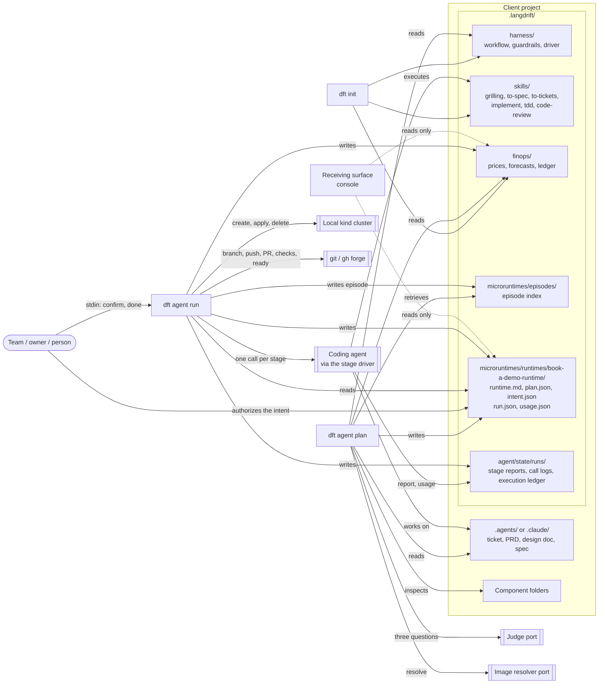

# The engine that reproduces the simulation

**Status:** accepted

**Serves:** PRD 0001. **Decided by:** ADR 0005 (Perfect Simulation Alignment). **Specs:** 0048–0066.

> **Main constraint (ADR 0005).** The engine does exactly what the home simulation shows: nothing more, nothing less. What it does beyond the simulation is removed; what the simulation shows and it lacks is built; what differs is both.
>
> **Execution order.** The specs run one at a time, in the order of the Build order section. A spec's tickets are written when an agent starts that spec, not in advance, and are implemented before the next spec starts.
>
> **Obligation.** Whoever writes tickets from this design doc, or implements them, first plays the simulation in production at https://langdrift.md/en/. They watch both phases: `dft agent plan` plays on load, and `dft agent run` plays after Play workflow. They change the Workflow choices (checkpoints, model, effort, a reservation over the budget) and expand every card. They compare what it shows with this document and with the specs it names, line by line and field by field. Where they differ, the simulation in production wins, and the difference is reported.

The PRD says what the MVP is and why. This document says how it is built: it narrates the session event by event, as the engine must produce it, and at each event names the element that acts, what it reads, what it decides and what it records in the client's `.langdrift/` folder. It adds no decision of its own. Where a spec decides, the spec is named. The specs were reconciled with each other and with the simulation, and Cross-spec consistency records how. What only the owner can decide is listed under Open questions. The evidence behind every line is `research/simulation-conformance.research.md`.

## Overview

The engine is the LangDrift CLI, `dft`, and it has three commands. `dft init` creates the client's `.langdrift/` folder. `dft agent plan <ticket id>` reads the team's own artifacts (the ticket, the PRD, the design doc, the spec, the FinOps guardrail, the project's earlier episodes and the component folders the spec names), reasons over them with a judge, and drafts a sized `runtime.md` that it proposes to the team. Nothing is built, started or paid for. `dft agent run` applies the intent the team authorized. It opens the money gate, plays the workflow's stages through the team's coding agent, waits inside the same command wherever a person must act, brings the microruntime up on a local cluster, pushes and opens a pull request, follows the client's CI checks, states Safe Seat, takes the runtime down and releases what the reservation did not spend.

Every terminal line and every field of the four cards (Ticket, Analysis, Plan, Workflow) is data the engine produces. The card is the specification of that data. The engine writes it, as each line prints, into hand-off records under `.langdrift/`. A receiving surface such as the console only reads those records. It never reasons, never sends and never authorizes. The `console ›` prefix on the terminal's lines is part of the output, not a claim that the console reasons. Every boundary outside the project sits behind a port: the judge, the image resolver, the coding agent, the cluster, the forge, the person at the keyboard and the clock. That lets one golden test script all of them.

The elements, each with its spec:

| Element | Spec | What it does in one sentence |
| --- | --- | --- |
| The LangDrift CLI | 0048 | The three commands, the session's comment lines, the line format, the stop rule and the golden test. |
| The LangDrift Core contracts | 0049 | The shapes everything else fills: the `runtime.md` fence, the judge's answers, the stage reports and the hand-off records. |
| The hand-off | 0050 | Writes the plan's card data and the proposed intent, and reads the authorized intent the run applies. |
| The judge | 0051 | Answers three questions (criteria, episodes, suggestion) and states the sizing basis. |
| The RAG episode index | 0052 | Embeds the ticket intent, retrieves episodes by cosine similarity, applies the 0.55 threshold, and writes each finished run's episode. |
| The project documents | 0053 | Resolves the ticket by its id, follows exactly its four links and extracts their facts by fixed rules. |
| The harness and its guardrails | 0054 | Reads the guardrail's criteria and states the design doc's envelope as the plan's bound. |
| `runtime.md` | 0055 | Sums the shares, checks them against the bound, validates the draft and writes it. |
| The money gates | 0056 | Prices, estimates, reserves with a 20% margin, gates, observes and releases. |
| The workflow and its human checkpoints | 0057 | The seven stages, the per-run choice, the waits answered on standard input and the run's ending. |
| The stage driver | 0058 | Starts the coding agent once per stage on the chosen model and effort, and reads its token usage. |
| The agent skills | 0059 | The report each skill writes and the one structured line per stage. |
| The effort hook | 0060 | Records the run's effort and unblocks implement. |
| Safe Seat | 0061 | The dev ticket the person writes with no paid call, and `Safe Seat met`. |
| The local cluster | 0062 | Brings the runtime up after the code review and leaves nothing behind. |
| Delivery | 0063 | The branch, the push, the pull request and its ready state. |
| The client's CI checks | 0064 | Follows the pull request's checks until they all pass. |
| Evidence and the usage record | 0065 | The run's record, the usage record and the run's outcome. |
| The client's components | 0066 | Resolves each component's manifest, stack, role, port, image and share. |



The data flows one way. The plan turns the team's documents into the plan's card data (`plan.json`), the draft that will run (`runtime.md`) and the intent the team is asked to authorize (`intent.json`). The team authorizes the intent outside `dft`. The run turns the authorized intent into the run's record (`run.json`), the usage record (`usage.json`) and a money-ledger entry. Once it completes, it also leaves a new episode that the next plan retrieves.

## Event timeline: phase 1

The session as the engine must produce it, one minimal event at a time, in order. Terminal lines are quoted exactly, with their kind (comment lines are dimmed, success lines green, warnings yellow, output lines in the default tone). Card texts are quoted as the card shows them. The card renders integers with the reader's grouping (`2,000m`); the records hold plain integers and cents.

### Before the command

1. A terminal window titled `dft — project` shows the prompt `~/project %`. Beside it, the panel's place is held by a pulsing placeholder. A Pause control sits in the terminal's title bar. In the simulation the session plays only while the terminal is on screen and the tab is visible; a visitor who asked for reduced motion sees the whole session at once and no control. The title belongs to the LangDrift CLI (0048): `dft agent plan` and `dft agent run` set it to `dft — <project folder name>` when standard output is a terminal. The placeholder, the control and the play-while-visible rule are the receiving surface's playback, not engine behavior (0048, Out of Scope).
2. The person types `dft agent plan 0031-TICKET-book-a-demo-runtime`, character by character, and presses enter. This is the person's shell, and `dft` never echoes the command (0048). The LangDrift CLI takes exactly one argument, the ticket's bare id, and finds the project root: the nearest folder upward that holds `.langdrift/`.
3. The panel fades in over the placeholder: four cards stacked, the Ticket card open and the other three collapsed to their header lines. The Ticket card already shows the number `0031`, the slug `book-a-demo-runtime`, the status `ready-for-agent` and the title `Run the book-a-demo request use case as a microruntime`. Under LINKED ARTIFACTS it lists PRD, Design doc, Spec and Guardrail, each with a dash meaning "Not set yet". The collapsed headers read `0031 · book-a-demo-runtime` (Ticket), a dash (Analysis), a dash (Plan) and `Sonnet 5.5 · medium · $9.50 of $25.00` (Workflow). The engine has these values before it prints anything:
    - The project-documents element (0053) resolves the ticket in the client's own `.agents/` or `.claude/` folder and reads its header: number, slug, status and title. It also resolves the design doc the ticket links and reads its budget per run, $25.00.
    - The hand-off (0050) writes the ticket's header and the whole `workflow` section into `plan.json` first. The `workflow` section holds the seven stages and the default choice from `harness/workflow.json` (0057), and the price list, forecasts and spend table with that budget (0056).

    The Workflow card's default choice, Sonnet at medium with Planning and Review, is the workflow's own. The judge's suggestion does not exist yet, and when it comes it does not change the default.

### The ticket act

4. `# plan only · nothing is built, started or paid for in this step` (comment). This is the LangDrift CLI's first printed line (0048). It is a promise every later element keeps: the embedder is local, the judge is neither priced nor gated, and nothing is reserved.
5. `console › tool call: read 0031-TICKET-book-a-demo-runtime` (output). The project-documents element (0053) resolves the bare id to the one file named `0031-TICKET-book-a-demo-runtime.ticket.md`. It looks in the client's own artifact folder, `.agents/` or `.claude/` at the project root, and not in `.langdrift/`. The ticket and the PRD, design doc and spec it links are the client's artifacts that take part in LangDrift's workflow. `.langdrift/` holds only LangDrift's workflow, skills, harness (guardrails included), prices and records. The line reports the read that already happened before the first line (event 3): the title from the first heading, the status from the `**Status:**` line, the number `0031` from the id's first four digits and the slug `book-a-demo-runtime` from what follows `-TICKET-`, all already in `plan.json`'s `ticket` section. The status is printed as read and gates nothing.
6. `console › ready-for-agent · links 0002-PRD · 0005-DD · 0011-SPEC · guardrail 0001-finops` (output). The project-documents element reads the ticket's Markdown links. It classifies each by suffix: `.prd.md` PRD, `.dd.md` design doc, `.spec.md` spec, `.gr.md` guardrail. It requires exactly one of each, names each by its short id, prints them in the order PRD, design doc, spec, guardrail, and labels the guardrail. The PRD, design doc and spec links stay inside the client's artifact folder; the guardrail link points at LangDrift's guardrail in `.langdrift/harness/guardrails/`. On the Ticket card, the four LINKED ARTIFACTS fade in: `PRD 0002-PRD-book-a-demo.prd.md`, `Design doc 0005-DD-book-a-demo-runtime.dd.md`, `Spec 0011-SPEC-book-a-demo-runtime.spec.md`, `Guardrail 0001-finops.gr.md`.

### The analysis act

7. `# analysis · reading the linked documents, then the project's episodes` (comment, 0048). The analysis act begins. The Analysis card opens, and the Ticket card collapses to `0031 · book-a-demo-runtime`. The Analysis card shows DOCUMENTS with four rows, each a file name with a dash. Under it are EPISODES with `threshold 0.55` and a dash, MEASURED RESOURCES with a dash, and SUGGESTED MODEL and SUGGESTED EFFORT with dashes.
8. `console › tool call: read 0002-PRD · use case: book-a-demo request` (output). The project-documents element reads the PRD's `**Use case:**` field line by a fixed rule, with no model involved. The PRD row turns to Read: `0002-PRD-book-a-demo.prd.md ✓ Read — use case: book-a-demo request`.
9. `console › tool call: read 0005-DD · envelope cpuMillis 2000 · memoryMiB 3072 · set by the team` (output). The project-documents element reads the design doc's `**cpuMillis:**`, `**memoryMiB:**` and `**Budget per run:**` lines. Those are the envelope in millicores and MiB, and the per-run model-call budget, 2500 cents. Their provenance is "set by the team", because the design doc is the team's document. The design-doc row turns to Read: `0005-DD-book-a-demo-runtime.dd.md ✓ Read — envelope 2,000m · 3,072 MiB · budget $25.00 per run · set by the team`.
10. `console › tool call: read 0011-SPEC · 5 components named · 3 acceptance criteria` (output). The project-documents element reads the spec's `## Components` section: one list item per component, its path in backticks, optionally followed by a port as `:<port>`. It also counts the `## Acceptance criteria` section's items. It keeps the five paths in the spec's order for the component inspection. The spec row turns to Read: `0011-SPEC-book-a-demo-runtime.spec.md ✓ Read — 5 components · 3 acceptance criteria`.
11. `✓ read       4 documents · nothing outside the ticket's links` (success). Reading is bounded: no link of a linked document is followed. The terminal's count is the ticket, the PRD, the design doc and the spec. DOCUMENTS gains its header figure `4 documents read`, and the Analysis header becomes `4 documents read`, the first of its three states (0051). The card's count is the number of documents the ticket links (PRD, design doc, spec and guardrail), counted from the resolved links (0053). So it can show here, before the guardrail row is read at the next line, as the simulation does. Which set "documents read" means stays the simulation's contradiction S2.
12. `reads      harness/guardrails/0001-finops.gr.md · FIN-02 · FIN-04` (output). The harness (0054) reads the guardrail the ticket links from `.langdrift/harness/guardrails/`. Its one criteria table has the columns `ID`, the rule and `Checked at`. The line names the guardrail's path under `.langdrift/` and the criteria checked at the plan step (FIN-02 and FIN-04, in table order). FIN-03 is scoped to the run (contradiction S3). The harness records the guardrail as a review rule: `dft` enforces no criterion. The guardrail row turns to Read: `0001-finops.gr.md ✓ Read — FIN-02 · FIN-03 · FIN-04 · review rule, no automatic enforcement`.
13. `console › judging · FIN-02 estimate before a paid call · FIN-03 a budget before a paid run · FIN-04 size cpu and memory to the load` (output). The judge (0051) answers its first question behind the judge port. Given each criterion's rule text, it returns one short statement per criterion. The answer is checked against the contract before the line prints: no criterion skipped, none invented. The statements follow table order. Under the guardrail row, the judgment fades in: `FIN-02: estimate before a paid call · FIN-03: a budget before a paid run · FIN-04: size cpu and memory to the load`.
14. `bounded    cpuMillis 2000 · memoryMiB 3072 · set by the team in the design doc` (output). The harness states the design doc's envelope as the plan's bound. No CLI flag, input record, mirror or ceiling takes part. The bound goes into the card data and, later, into the `runtime.md` draft with its source. On the Plan card, still collapsed, BOUNDED becomes `2,000m · 3,072 MiB`.
15. `budget     $25.00 per run for model calls · set by the team in the design doc` (output). The money gates (0056) state the per-run budget that the project-documents element extracted, with its source. No card field changes; the budget is already on the design-doc row.
16. `console › RAG over project episodes · a model and effort for this ticket` (output). The RAG episode index (0052) begins. SUGGESTED MODEL and SUGGESTED EFFORT change from dashes to pulsing "Resolving" placeholders.
17. `console › embedding the ticket intent · 1 query vector` (output). The RAG embeds the ticket intent (the ticket's title and body) into one query vector with the local deterministic embedder. The embedding makes no paid call.
18. `console › vector search · project episodes · top 6 by cosine similarity` (output). The RAG searches the episode index at `.langdrift/agent/state/rag/index.json`, which holds one stored vector per episode, by cosine similarity. It rebuilds the index from the episode records only if the index is missing or was built by another embedder. EPISODES shows six pulsing placeholder rows.
19. `console › 6 candidates · similarity 0.81 to 0.42` (output). The RAG takes the six highest similarities, in descending order (ties by ascending id), and records them as candidates in `plan.json`'s `analysis.episodes`. The six rows fade in, each with its `ep-NNNN` id, slug, similarity figure and a bar of the similarity: `ep-0412 checkout-preview-sizing 0.81`, `ep-0388 notify-api-rollout 0.74`, `ep-0351 signup-redesign-preview 0.66`, `ep-0297 docs-search-index 0.52`, `ep-0240 batch-export-worker 0.47`, `ep-0188 storefront-cache-warmup 0.42`.
20. `console › judging · 3 share the stack and scale · 3 differ: other runtime, no broker, docs only` (output). The judge answers its second question. For each candidate it gets the episode record, the similarity and the threshold's verdict, together with the documents and the extracted facts. The episode record holds the components with their stacks and roles, the workload, and the intent the episode was embedded from. The judge returns a verdict that must equal the threshold's, and a reason from the closed set: `shares the stack and scale` when kept; `other runtime`, `no broker` or `docs only` when dropped. The line lists the distinct drop reasons in the set's order. No card field changes yet.
21. `console › dropped 3 below 0.55 · kept 3` (output). The RAG applies the strict threshold: a candidate is kept exactly when its similarity, at two decimals, is at least 0.55. No structured score can keep one below it. Each row gains its verdict. The three kept rows read `kept` in the success tone. The dropped rows fade back and read `dropped · docs only`, `dropped · other runtime` and `dropped · no broker`. The Analysis header's second state is `3 of 6 episodes kept`.
22. `console › 3 episodes cited · none with measured resources` (output). The RAG counts the cited episodes whose `measured` peaks are not null; every episode the product writes has `measured: null`. MEASURED RESOURCES reads `none cited`.
23. `console › reasoning · no cited episode measured cpu or memory · sizing follows the spec, not history` (output). The judge states the sizing basis. With no cited episode that measured cpu or memory, the components are sized from the spec's components, not from history. The statement follows from the RAG's count and asks the model nothing. MEASURED RESOURCES adds `sizing follows the spec, not history`.
24. `console › weighing effort · low skips the broker wiring · high is not warranted by 5 components` (output). The judge answers its third question: which model and effort the ticket warrants. It gets the documents, the facts (the five components among them), the cited episodes, the three models of the price list and the efforts low, medium and high. It must name each effort it did not choose, in ascending order. Here the reasoning is that low effort would skip the broker wiring and high is not warranted by five components.
25. `console › weighing model · Haiku 5.5 retries the broker wiring · Opus 5.5 costs more per outcome` (output). The same answer must name each model it did not choose, by short name, in ascending list price. Here Haiku would retry the broker wiring and Opus costs more per outcome.
26. `✓ suggests   claude-sonnet-5-5 · effort medium` (success). The suggestion is recorded in `plan.json`'s `analysis.suggestion` as a recommendation, never as an authorization. SUGGESTED MODEL becomes `Claude Sonnet 5.5` with `claude-sonnet-5-5` beneath it. SUGGESTED EFFORT becomes `medium`. The note `recommendation · the team authorizes` appears. The Analysis header's third state is `Claude Sonnet 5.5 · effort medium`.

### The plan act

27. `# plan · resolving the components, then sizing them inside the envelope` (comment, 0048). The plan act begins. The Plan card opens, and the Analysis card collapses to `Claude Sonnet 5.5 · effort medium`. The Plan card shows PROPOSED PLAN with a dash, CPU and Memory with dashes and empty bars, COMPONENTS with a dash, and the report: BOUNDED `2,000m · 3,072 MiB` already set, with HEADROOM, SUGGESTED RESOURCE, GPU · DISK, PRICE and VALIDATION dashed.
28. `console › resolving 5 components named in the spec · paths, images, ports` (output). The client's-components element (0066) takes the five paths the spec named, in the spec's order. PROPOSED PLAN, CPU and Memory turn to "Resolving" placeholders. COMPONENTS shows five pulsing rows with empty bars and a placeholder total.
29. `console › tool call: inspect services/signup-api · go.mod · :8080` (output). The component element reads the folder's manifest by fixed precedence: `next.config.ts`, then `go.mod`, then `package.json`, then `nats.conf`, then `redis.conf`. Here the manifest is `go.mod`: Go, api. `go.mod` declares no port, and Go has no conventional port, so the port is the one the spec names beside the path. It resolves the component's image through the image resolver port. No Dockerfile, healthcheck, env file or ceiling is read.
30. `✓ services/signup-api   Go · api        250m · 256 MiB` (success). The share comes from the fixed per-stack sizing table: Go api 250m and 256 MiB. The component (path, manifest, stack, role, port, image, share) goes to `plan.json`'s `plan.components`. `runtime.md` (0055) adds it to the running totals. The first row fills: the Go mark, `services/signup-api`, `Go`, `api`, `250m`, `256 MiB`, and a bar of its CPU against the 2,000m bound. The total reads `1 of 5 resolved · 250m · 256 MiB`. PROPOSED PLAN and the Plan header become `250m · 256 MiB`. CPU reads `250m of 2,000m` and Memory `256 MiB of 3,072 MiB`, and both bars grow.
31. `console › tool call: inspect services/notify-api · package.json · :8081` (output). The manifest is `package.json`: Node.js, api. The port comes from `PORT=8081` in its start script.
32. `✓ services/notify-api   Node.js · api   300m · 512 MiB` (success). The table gives Node.js api 300m and 512 MiB. The second row fills. The total reads `2 of 5 resolved · 550m · 768 MiB`. The figures and bars step to `550m · 768 MiB`.
33. `console › tool call: inspect platform/nats · nats.conf · :4222` (output). The manifest is `nats.conf`: NATS, broker. The port comes from its `port: 4222`.
34. `✓ platform/nats         NATS · broker   200m · 256 MiB` (success). The third row fills. The total reads `3 of 5 resolved · 750m · 1,024 MiB`, and the figures step to `750m · 1,024 MiB`.
35. `console › tool call: inspect platform/redis · redis.conf · :6379` (output). The manifest is `redis.conf`: Redis, cache. The port comes from its `port 6379`.
36. `✓ platform/redis        Redis · cache   200m · 256 MiB` (success). The fourth row fills. The total reads `4 of 5 resolved · 950m · 1,280 MiB`, and the figures step to `950m · 1,280 MiB`.
37. `console › tool call: inspect apps/signup · next.config.ts · :3000` (output). `next.config.ts` takes precedence over the `package.json` beside it: Next.js, web. It sets no port, so the port is the stack's conventional 3000.
38. `✓ apps/signup           Next.js · web   500m · 1024 MiB` (success). The fifth row fills. The total becomes `5 components · 1,450m · 2,304 MiB`. PROPOSED PLAN and the header read `1,450m · 2,304 MiB`, CPU `1,450m of 2,000m` and Memory `2,304 MiB of 3,072 MiB`.
39. `console › cross-checking · 5 ports distinct · 5 images resolved · no collisions` (output). The component element cross-checks the five components: distinct ports, every image actually resolved, and no two sharing a path, a port or an image. The ports line appears under the rows: `ports 8080 · 8081 · 4222 · 6379 · 3000 · distinct · no collisions`.
40. `✓ size       1450m of 2000m · 2304 of 3072 MiB · 5 one-replica Deployments · proposed shares` (success). `runtime.md` (0055) sums the components' own shares rather than splitting the envelope equally. It checks the sum against the bound and computes headroom as the bound minus the sum. It proposes one one-replica Deployment per component. HEADROOM becomes `550m · 768 MiB` and SUGGESTED RESOURCE `5 one-replica Deployments`.
41. `limits     gpu and disk are not runtime.md fields · none requested` (warning). `runtime.md` states the limits. The fence has no gpu or disk field, and no extracted fact requests one. GPU · DISK becomes `not runtime.md fields`.
42. `estimate   runtime has no price source · cpu and memory stay in millicores and MiB` (output). The money gates state that the runtime itself has no price source. PRICE becomes `runtime: no price source · units only`, in the warning tone. The money gates also price every model and effort pair into the plan's spend table (see Shared contracts).
43. `console › tool call: validate runtime.md draft against the schema · 0 errors` (output). `runtime.md` builds the draft's `langdrift` fence, version 3 of the LangDrift Core contracts (0049). The fence holds the runtime id, the revision, the bound, the suggested model and effort, and per component its path, stack, role, port, image, share and replica count. `runtime.md` validates the fence against the published JSON Schema. Every error is counted, never stopping at the first, and the count is 0. Only then does it write `.langdrift/microruntimes/runtimes/book-a-demo-runtime/runtime.md` as revision 1, with the sizing report beside the fence. VALIDATION becomes `schema · 0 errors`.
44. `✓ plan       runtime.md draft, revision 1 · proposed to the console` (success). The hand-off (0050) writes the proposed intent, `intent.json`, beside the draft. It holds the ticket id, the runtime id, revision 1, and the workflow's default choice from `harness/workflow.json`, `claude-sonnet-5-5` at `medium`, with Planning and Review ticked (0057). That is the choice the Workflow card has shown since the panel appeared. The judge's suggestion stays a recommendation, on the Analysis card and in the draft. Its status is `proposed`. The hand-off sets `plan.authorization` to pending and the evidence (the draft, its state, revision 1, proposed to the console) in `plan.json`. PROPOSED PLAN and the Plan header gain `· pending team authorization`. EVIDENCE appears: `runtime.md draft · revision 1 · proposed to the console`.

### The hand-off

45. `# next: once the team authorizes, dft agent run applies the recorded intent` (comment, 0048). The plan ends and exits 0. The Workflow card opens, and the Plan card collapses to `1,450m · 2,304 MiB · pending team authorization`. The Workflow card shows HUMAN IN THE LOOP, one row per stage:
    - Planning `grilling`, ticked and unavailable, with the note `Planning always has a person in this workflow` on hover or focus;
    - Spec `to-spec`, Tickets `to-tickets` and Implement `implement · tdd`, unticked;
    - Dev ticket `driven by the person`, with no box;
    - Review `code-review`, ticked;
    - Merge with its mark and `always the owner's`.

    Below the stages:
    - MODEL offers Claude Opus 5.5, Claude Sonnet 5.5 and Claude Haiku 5.5, with Sonnet chosen and `$2.00 / $10.00 per MTok · list price, Oct 2026` beneath.
    - EFFORT offers low, medium and high, with medium chosen.
    - ESTIMATED SPEND reads `$9.50`, then `3.5M input · 250K output · uncached list prices`, then `reserves $11.40 of the $25.00 budget` with a bar at the reservation's share of the budget.
    - The `Play workflow` button becomes available. Until now it carried the note `available once the plan is drafted`.

    These values were written into `plan.json`'s `workflow` section before the plan's first line (event 3): the workflow's stages and default choice (0057), and the money gates' price list, forecasts and spend table (0056). The receiver computes nothing. The terminal's title-bar control changes from Pause to Replay.

## Event timeline: phase 2

Between the phases, the team authorizes. In the simulation that is the Workflow card: the team picks the human stages, the model and the effort, and plays. In the product, the team edits `intent.json` and sets its status to `authorized`, outside `dft`. `dft` never authorizes, and the run applies whatever choice the team authorized (0050, 0057; open question 5). The narration follows the default choice: Claude Sonnet 5.5, medium, Planning and Review ticked.

1. The person presses `Play workflow`. The button reads `Starting…` with a small loader. The choices lock. The Workflow card comes to the front. The page scrolls the terminal into view. The finished plan stays in the terminal for a moment, and the title-bar control returns to Pause. In the product, the counterpart is a person typing `dft agent run`. The launch state is the receiving surface's playback, not engine behavior (0048, Out of Scope).
2. The terminal clears, the prompt returns, and `dft agent run` is typed character by character, with no argument (0048). The button reads `Playing…`. On the Workflow card every stage is pending, and a result area appears below. It holds RESERVED, OBSERVED and RELEASED, each a dash, PULL REQUEST with a dash and SAFE SEAT with a dash. The plan's cards keep their end state, collapsed to their headers. Before printing anything, the engine gives the run its id, `book-a-demo-runtime-0001`: the runtime id and the next four-digit sequence among that runtime's ledger entries (0065). It then runs three checks; any failure is a stop with nothing printed and nothing reserved:
    - The LangDrift CLI selects the one intent under `.langdrift/microruntimes/runtimes/` whose status is `authorized` and that has no completed run. Evidence (0065) reports which runs completed.
    - The hand-off checks that this intent's revision is the draft's current revision, that its model is in the price list and that its effort is one of the three.
    - The stage driver (0058) reads `.langdrift/harness/driver.json`. It refuses a missing file, or one whose arguments do not carry the model and effort placeholders.
3. `# run · 0031-TICKET-book-a-demo-runtime · the recorded intent, authorized by the team` (comment). The hand-off prints the run's header. The words "the team" are fixed, because only an authorized intent runs. Evidence (0065) opens the run's record, `run.json`, beside the draft: the applied intent, and the outcome `running`.
4. `console › intent     claude-sonnet-5-5 · effort medium · runtime.md revision 1` (output). The hand-off prints the applied model, effort and revision. It hands the choice to the money gates, the workflow and the stage driver, and the revision to the local cluster.
5. `console › estimate   $9.50 · 3.5M input · 250K output · list prices · FIN-02` (output). The money gates take the applied pair's row from the plan's spend table. The spend is computed in integer cents, half up, from 3,500K input and 250K output tokens at Sonnet's list price. The line cites FIN-02, "estimate before a paid call". The money gates open the run's entry in the money ledger, `.langdrift/finops/ledger/book-a-demo-runtime-0001.ledger.json`.
6. `console › budget     $25.00 per run · set by the team · FIN-03` (output). The money gates state the design doc's budget and cite FIN-03, "a budget before a paid run". Nothing has been reserved or paid yet.
7. `console › gate       reserved $11.40 of $25.00 · opened` (success, with no mark). The money gates reserve the estimate plus the fixed 20% margin, rounded up: $11.40. The reservation fits the $25.00 budget, so the gate opens. The ledger records the reservation and `gate: opened`. RESERVED becomes `$11.40`. Silently, delivery (0063) starts the branch `feat/0031-book-a-demo-runtime` from the checked-out commit, or checks it out if an earlier run of the ticket left it. The stages and the person work on it.
8. `console › waiting    planning · the owner confirms` (output). The workflow (0057) reaches Planning, which is always ticked. It records the stage as waiting in `run.json` and reads one line from the run's standard input, without echo in a terminal. No prompt line is printed, and no runtime is up. The Planning row takes the primary tone and reads `waiting for the owner`.
9. `✓ confirmed  planning · by the owner` (success). The owner answers in the same terminal. The workflow records the stage as confirmed by the owner. Planning still reads `waiting for the owner` while its work runs.
10. `console › grilling   3 open questions settled` (output). The workflow plays its first stage. Each stage of LangDrift's opinionated workflow (`harness/workflow.json`) executes one of the skills `dft init` installed under `.langdrift/skills/`. These are the same workflow and skills LangDrift uses on its own work. Each skill works on the client's own ticket and documents in `.agents/` or `.claude/`. The stage driver starts the team's coding agent once for Planning. The call carries the skill text `grilling`, the ticket, the applied model and effort (as argument placeholders and as environment variables), and the path where the skill must write its report. The agent skill (0059) writes its report: three open questions settled. `dft` checks the report against the stage-report shape of the LangDrift Core contracts and prints the line from its figures, never from the agent's free output. The stage driver reads the call's input and output tokens from the agent's JSON output. Evidence appends the call to the usage record, `usage.json`, and keeps the report's figures in `run.json`. Planning gets its done mark.
11. `console › to-spec    0011-SPEC revised · 3 acceptance criteria` (output). Spec is unticked, so it runs without waiting. One call with the skill `to-spec`; its report says the linked spec was revised and now holds three acceptance criteria. The short id follows the project-documents rule. Spec goes from pending straight to done.
12. `console › to-tickets 3 tickets · blocking edges recorded` (output). Tickets is unticked: one call with `to-tickets`. Its report gives three tickets with their blocking edges recorded. Tickets is done.
13. `console › hook       effort recorded · implement unblocked` (output). The effort hook (0060), a built-in step at the start of Implement, writes the effort record into `run.json`. The record holds the applied model and effort beside the judge's suggested pair, with a timestamp. Implement may start only when that record exists and matches the applied choice. Implement takes the primary tone.
14. `console › implement  tdd · 5 components · 14 files · boundary only · stops at the reserved part` (output). One call with `implement · tdd`: one stage, one paid call, one line. Its report says the work was test-first, touched five components and fourteen files, wrote the boundary only and stopped at the reserved part. Implement is done.
15. `console › waiting    dev-ticket · the person writes the reserved part` (output). Safe Seat (0061) runs the dev-ticket stage, which every run has and no choice removes. The run waits on its standard input for the person's "done". While it waits, no stage-driver call is allowed. The Dev ticket row takes the primary tone and reads `the person writes the reserved part`.
16. `✓ closed     dev-ticket · written without an agent · no paid call` (success). The person signals done. Safe Seat records the stage as done, closed by the person, with zero paid calls, a known zero. The Dev ticket row gets its done mark.
17. `console › code-review 2 findings · fixed` (output). Review's skill runs after the dev ticket. It runs without a waiting line, even though Review is ticked: the tick only decides how the run ends. One call with `code-review`; its report gives two findings, both fixed. Review takes the primary tone.
18. `runtime    book-a-demo-runtime · revision 1 · 5 Deployments ready · 1450m · 2304 MiB` (output). Only now does the local cluster (0062) bring the runtime up. It records each step first in its private execution ledger, `agent/state/runs/book-a-demo-runtime-0001/execution.json`. Before the bring-up, it deletes any cluster that an earlier, stopped run of the runtime left recorded. It creates a kind cluster `langdrift-book-a-demo-runtime` and makes each resolved image available to it. It applies one one-replica Deployment per component of the applied `runtime.md` revision, named after the path (`services-signup-api`, …), with CPU and memory requested and limited at exactly the proposed share. It waits until every Deployment reports itself available. The figures are the sum of the shares. `run.json`'s runtime section records the state as ready. No card field changes.
19. `✓ completed  implementation · $9.80 observed of $11.40 reserved · usage record` (success). Evidence sums the usage record's five calls: 3,700K input and 240K output tokens. The money gates price them at the same list price as the estimate, $9.80, and the ledger records the observed spend. OBSERVED becomes `$9.80`.
20. `✓ pushed     feat/0031-book-a-demo-runtime · 3f9c2e1` (success). Delivery pushes the branch to `origin` with its upstream set and records the branch and the pushed head's seven-character short hash in `run.json`. No card field changes.
21. `✓ pr #19     feat(demo): run book a demo as a microruntime` (success). Delivery opens a draft pull request with `gh`, from the branch to the default branch, titled with the subject of the branch's first commit. If an earlier run of the ticket left an open pull request on the branch, delivery uses that one instead. It records the number and the title, with the state `draft`. Delivery owns PULL REQUEST, which shows `#19 · 3f9c2e1` with a pull-request mark from this line on. The simulated link opens nothing.
22. `checks     build · check · test · guardrails · running` (output). The CI-checks element (0064) polls the pull request's checks through the forge port until the forge lists at least one. It then names every check in the forge's order. It records the checks' state, `running`, beside the pull request in `run.json`, and PULL REQUEST's state reads `checks running` (0063 shows what 0064 records). The checks' names and per-check results are not kept.
23. `✓ checks     4 of 4 passed` (success). The CI-checks element polls until every check has completed, with no deadline, and prints the line only when the number passed equals the number listed. It records the state `passed`, 4 of 4, and PULL REQUEST's state becomes `4 of 4 checks passed`, in the success tone.
24. `✓ Safe Seat  met` (success). Safe Seat decides: the dev ticket closed with no paid call during it, and the checks have passed. It records `safeSeat: met` in `run.json`. SAFE SEAT becomes `met`, in the success tone, never a share.
25. `runtime    stopped · 5 Deployments removed · nothing left` (output). The local cluster deletes each Deployment, deletes the cluster and confirms with kind that the cluster no longer exists. It settles the execution ledger. "Nothing left" is true: no cluster, Deployment or container of the run survives. `run.json` records the runtime as stopped, five removed, none left. No card field changes.
26. `✓ ready      #19 for review · $1.60 released to the envelope` (success). Delivery marks the pull request ready with `gh`. The words "for review" follow only the Review tick, which the workflow records. The money gates release the reservation minus the observed spend, $1.60, and the ledger records it. Evidence sets the outcome to `completed`. RELEASED becomes `$1.60`. PULL REQUEST's state becomes `ready for review`. The Review row gets its done state and, because Review is ticked, reads `waiting for the owner`. The Workflow header becomes `#19 · ready for review · $9.80`. The simulation also announces the end to screen readers; that announcement is built from the same figures and is not product data (0056).
27. `# next: the owner reviews #19 and decides whether to merge` (comment). The workflow prints the closing comment. The run exits 0, and nothing in `dft` merges. Once evidence reports the outcome `completed`, the RAG episode index writes the run's episode, `.langdrift/microruntimes/episodes/ep-0413-book-a-demo-runtime.json`. It holds the next free `ep-NNNN` id, the slug, the ticket, the intent embedded, the components with their stacks and roles, the resource, and `measured: null`. Its vector goes into the index, computed once. The terminal ends, the button reads `Play again`, the choices unlock and the title-bar control becomes Replay.

After the default run, HUMAN IN THE LOOP reads Planning ✓ · Spec ✓ · Tickets ✓ · Implement ✓ · Dev ticket ✓ · Review `waiting for the owner` · Merge `always the owner's`. The Plan card still reads `pending team authorization`, because `plan.json` is never rewritten after the plan (contradiction S1).

## Variants

**Changing the Workflow choices.** Before a run, or after one has ended, the team changes the choices on the Workflow card. Every change immediately recomputes four things:
- the header, `{short name} · {effort} · {estimate} of {budget}`;
- the price line under MODEL;
- ESTIMATED SPEND: the estimate, the compact token counts, the reservation and its bar;
- the over-budget warning.

Each change is a lookup in the plan's spend table; the receiver computes nothing (0056). Some examples:
- Choosing Claude Opus 5.5 shows `$4.00 / $20.00 per MTok · list price, Oct 2026`, and Haiku shows `$0.10 / $0.50 per MTok · list price, Oct 2026`.
- Low effort on Haiku reads `$0.26`, `2M input · 120K output · uncached list prices`, `reserves $0.32 of the $25.00 budget`.
- When the reservation exceeds the budget, as with Opus at high effort, the header reads `Opus 5.5 · high · $34.00 of $25.00`. ESTIMATED SPEND reads `$34.00` and `6M input · 500K output · uncached list prices`, and `reserves $40.80 of the $25.00 budget` with its bar in the warning tone. `over the budget · the gate will pause this run` follows.

The Planning box cannot be unticked. The Dev ticket and Merge rows have no box. While a run starts or plays, every choice is locked. The card starts from the workflow's default choice in `harness/workflow.json`, not from the judge's suggestion (0057). In the product, the choice lives in `intent.json`, and the team changes it before authorizing; the run applies whatever was authorized (0050, 0057).

**Another model or effort.** The run plays the same lines with other figures. The `intent` line carries the applied pair. The `estimate` line carries the pair's estimate and tokens. The gate reserves the pair's reservation. The stage driver passes the pair to every call. The `completed` line prices the observed tokens at that model (`$19.60 observed of $22.80 reserved` for Opus at medium). The `ready` line releases the difference.

**A checked stage waits.** When Spec, Tickets or Implement is ticked, that stage prints its own waiting pair before its work, and the run waits for the owner on standard input:
- With Spec ticked, `console › waiting    spec · the owner confirms` and `✓ confirmed  spec · by the owner` come between `grilling` and `to-spec`.
- With Tickets ticked, `console › waiting    tickets · the owner confirms` and `✓ confirmed  tickets · by the owner` come between `to-spec` and `to-tickets`.
- With Implement ticked, `console › waiting    implement · the owner confirms` and `✓ confirmed  implement · by the owner` come between `to-tickets` and the `hook` line, so the effort hook runs only once the owner lets Implement go (0060).

On the card, a ticked stage reads `waiting for the owner` from its waiting line until its last line has printed, then gets its done mark.

**Review unchecked.** Everything plays the same until delivery. Then the ready line reads `✓ ready      #19 to merge · $1.60 released to the envelope`, and the closing comment reads `# next: the merge stays the owner's`. PULL REQUEST's state reads `ready to merge`. The Workflow header reads `#19 · ready to merge · $9.80`. The Review row ends with its done mark instead of `waiting for the owner`. `code-review` still runs, without waiting (0057, 0063).

**Over budget.** With Opus at high effort, the run prints its header and these lines:
- `console › intent     claude-opus-5-5 · effort high · runtime.md revision 1`;
- `console › estimate   $34.00 · 6M input · 500K output · list prices · FIN-02`;
- `console › budget     $25.00 per run · set by the team · FIN-03`.

Then the money gates find the reservation over the budget, and the gate prints in the warning tone:

```
console › gate       reservation $40.80 exceeds the $25.00 budget · paused
```

The ledger records `gate: paused`, with nothing observed, and evidence sets the outcome to `paused`. On the card, the result area shows `paused at the gate · needs a decision` and `reserves $40.80 of the $25.00 budget · nothing paid` in place of RESERVED, OBSERVED, RELEASED, PULL REQUEST and SAFE SEAT. The Workflow header reads `paused at the gate`, and every stage stays pending. Then:

```
# needs a decision: raise the budget or lower the effort · nothing was paid for
```

The run ends there and exits 0, because the pause is a shown ending, not a failure (0048). No branch is started. No stage-driver call, cluster or forge operation happens. No usage entry and no episode are written. The button reads `Play again`.

**Play again.** After a run ends, `Play again` plays a new run with the current choices, from `Starting…` on, exactly as phase 2. In the product this is a second `dft agent run` of the same intent. Under 0048, a completed intent is not runnable again and a stopped one restarts from the gate. A restarted run reuses the branch and the open draft pull request an earlier run left (0063). Whether a second run may happen at all is open question 8.

**Pause, Resume and Replay.** While the plan or a run plays, the title-bar control reads Pause. Pressing it freezes the terminal mid-line, and the cards with it; the control then reads Resume. Once the terminal has ended, the control reads Replay. Replay hides the panel behind its placeholder again, clears the terminal and plays the plan from the typed command, keeping the visitor's Workflow choices. A real `dft` run can be neither paused nor replayed. These controls are the receiving surface's playback, not engine behavior (0048, Out of Scope).

**Opening a card by hand.** At any moment, clicking a collapsed card opens it and keeps it open until the next act takes the cards back. During a run, the Workflow card is in front. Collapsed cards keep their header figures. Which card is open is layout, the receiving surface's concern (rule 12, item 3).

## The .langdrift/ tree

`.langdrift/` is LangDrift's own folder in the client's project (0048). It holds four things:
- the opinionated spec-driven development workflow that `dft init` sets up, in `harness/workflow.json` (0057);
- the skills that workflow executes, which `dft init` installs under `skills/`: `grilling`, `to-spec`, `to-tickets`, `implement`, `tdd` and `code-review` (0059);
- the FinOps harness, with its guardrails and the price list;
- the records that plan and run leave.

The client's artifacts that take part in the workflow live outside it, in the client's own `.agents/` or `.claude/` folder at the project root (0053). Those artifacts are the tickets, and the PRD, design doc and spec each ticket links. So is the client's code, including the component folders the spec names. LangDrift brings the workflow and runs it; the client brings the work it runs on.

LangDrift ships the workflow it uses on its own work (0048, 0057, 0059). The skills `dft init` installs are the workflow's skills, taken from this repository's `.claude/skills/`: `grilling`, `to-spec`, `to-tickets`, `implement`, `tdd` and `code-review`. This repository's workflow also runs `domain-modeling` beside grilling and `llm-effort-analyzer` before implement; whether those ship too is an open question (0060). The workflow `dft init` writes is this repository's spec-driven workflow, as `.agents/context.md` and `.agents/policy/human-in-the-loop.policy.md` describe it. In this repository they sit outside any `.langdrift/` folder; in a client's project they arrive under `.langdrift/`.

Inside `.langdrift/`, `dft init` lays down the workflow, the skills and the harness, the plan fills the runtime's folder with its proposal, and the run adds its evidence. The runtime's folder is named after the ticket's slug, `book-a-demo-runtime`. Paths below are under `.langdrift/`.

### What `dft init` creates

`dft init` asks nothing, prints nothing and exits 0. It keeps any file already there byte for byte, so running it twice changes nothing (0048). It writes the following files, and each file's content belongs to the element that reads it:

| File | Whose content | What it holds, in words | What it feeds |
| --- | --- | --- | --- |
| `finops/prices.json` | The money gates (0056) | The three Claude models with their names, short names and input and output list prices in cents per million tokens: Opus 5.5 $4.00/$20.00, Sonnet 5.5 $2.00/$10.00, Haiku 5.5 $0.10/$0.50. Read on 2026-10-06, uncached. | The MODEL choice and its price line, the Workflow header's short name, every money figure, and the model ids the judge, the intent and the stage driver use |
| `finops/forecasts.json` | The money gates (0056) | The expected tokens per effort: low 2,000K input and 120K output; medium 3,500K and 250K; high 6,000K and 500K | The estimate and the token figures |
| `harness/workflow.json` | The workflow (0057) | LangDrift's opinionated spec-driven workflow: the seven stages in order with their skill text and who acts (Planning required; Spec, Tickets, Implement and Review optional; Dev ticket the person's own work; Merge always the owner's), and the default choice: Claude Sonnet 5.5 at medium, with Planning and Review | HUMAN IN THE LOOP, the default ticks, the default MODEL and EFFORT the Workflow card shows before any suggestion, the waits, the order of the stage calls |
| `skills/` | The agent skills (0059) | One folder per skill the workflow executes, the same skills LangDrift uses on its own work: `grilling` for Planning, `to-spec` for Spec, `to-tickets` for Tickets, `implement` and `tdd` for Implement, `code-review` for Review. Each skill ends by writing its stage report. | Every stage line of the run |
| `harness/guardrails/0001-finops.gr.md` | The harness (0054) | The FinOps guardrail, one criteria table with `ID`, the rule and `Checked at`: FIN-02 at plan and run, FIN-03 at run, FIN-04 at plan. From then on it is the team's document. | The `reads` line, the guardrail row, the judge's criteria question |
| `templates/` | The LangDrift CLI (0048) | Four empty document templates (ticket, PRD, design doc, spec) carrying only the field lines and sections the project-documents element reads | The team's documents; plan and run never read them |

The team writes `harness/driver.json` itself (0058): the coding agent's command, its arguments with placeholders for the prompt, model, effort, report path, skill, stage, ticket and run, the variables passed through, and where in the agent's JSON output the input and output token counts sit. A run without it, or with one that cannot pass the model and effort, stops before it prints anything (0058).

### What the plan writes

| Record | Who writes it | What it holds, in words |
| --- | --- | --- |
| `microruntimes/runtimes/book-a-demo-runtime/runtime.md` | `runtime.md` (0055), with the fence of the Core contracts (0049) | The `langdrift` fence, version 3: the runtime id, the revision, the bound, the suggested model and effort, and per component its path, stack, role, port, resolved image, proposed share and one replica. Beside the fence, the sizing report: the proposed totals, the bound with its source, the headroom, the resource, the limits statement and the validation result. Written only when the schema reports 0 errors. |
| `…/book-a-demo-runtime/plan.json` | The hand-off's card-data writer (0050), filled by every plan element | The plan's card data: the ticket; the documents, episodes and suggestion of the Analysis card; the components, sizing, price, authorization and evidence of the Plan card; and the Workflow card's stages, models, forecasts, spend table, budget and margin. It is replaced atomically each time a line reveals a field, so a receiver can fill the cards live. A field is absent until its line prints, an unknown value is null and never zero, and figures are units, not formatted text. The run never rewrites it. |
| `…/book-a-demo-runtime/intent.json` | The hand-off (0050) | The proposed intent: the ticket, the runtime id and revision, the model, the effort, the human stages (Planning always on) and the status `proposed`. The team later sets it to `authorized`. |
| `agent/state/rag/index.json` | The RAG (0052) | The episode index: the embedder's identity and dimensions, and one stored vector per episode. Written only when it was missing or built by another embedder. |

A plan that stops leaves `plan.json` as far as it got, and writes no draft and no intent.

### What the run writes

| Record | Who writes it | What it holds, in words |
| --- | --- | --- |
| `…/book-a-demo-runtime/run.json` | Evidence (0065), with one section per element | The run's record, replaced atomically as each line prints: the applied intent; each stage's state and who confirmed it, and the Review tick (workflow); each stage report's figures (agent skills); the effort record (effort hook); the dev ticket's closing and the Safe Seat result (Safe Seat); the runtime's state (local cluster); the branch, commit and pull request (delivery) with the checks' state PULL REQUEST shows (CI checks); the run's id; and the outcome, `running`, `paused`, `stopped` or `completed`. |
| `…/book-a-demo-runtime/usage.json` | Evidence (0065) | The usage record: one entry per run that made a paid call, with the applied pair, each stage-driver call's input and output tokens, and the totals. A total is null when any call went unreported. |
| `finops/ledger/book-a-demo-runtime-0001.ledger.json` | The money gates (0056), named by the run's id (0065) | The run's money: the pair, the expected tokens, the estimate, the budget, the margin, the reservation, the gate's outcome, then the observed tokens, the observed spend and the release, all in cents. |
| `microruntimes/episodes/ep-0413-book-a-demo-runtime.json` and its index entry | The RAG (0052) | The episode the next plan retrieves. It is written only for a completed run. |
| `agent/state/runs/book-a-demo-runtime-0001/stages/` | The stage driver (0058) and the skills (0059) | Private and ignored: each call's log, never evidence, and each stage's report |
| `agent/state/runs/book-a-demo-runtime-0001/execution.json` | The local cluster (0062) | Private: the cluster and Deployments the run created, written before each creation and settled with what was removed. A later run of the same runtime reads the unsettled ones to clean up what a stopped run left. |

The run's id, `<runtime id>-<NNNN>`, is given by evidence (0065) when the run starts. It names the ledger file and the private run folder, and the stage driver passes it to the coding agent.

Outside `.langdrift/`, the run leaves the branch and the ready pull request. The kind cluster exists only between the two runtime lines.

### What never appears again

Every spec removes records that feed no line or field, and none of them is written again:
- the project identity file, input records and their lock, the mirrors, and `harness/envelope.json`;
- the budgets and gates files, the numbered price-list folder, the execution rules file and the CI Gates workflow (0048, 0054, 0056);
- the `langdrift-plan` fence inside `runtime.md` (0050);
- laps, the per-runtime `run.md` memory with its `langdrift-run` fence, the run lock, the planning spend, provisional billing and proposed ticket statuses (0052, 0056, 0057, 0065).

## Phase 1: dft agent plan

The plan is a relay. Each element reads what the previous one established, prints its lines, and hands its values to the hand-off's single card-data writer. No element writes `plan.json` directly. Before the first line, the plan already writes two things the panel shows from the start. The first is the ticket's header, which the project documents (0053) read along with the design doc's budget. The second is the Workflow card's data: the workflow's stages and default choice (0057), and the money gates' price list, forecasts and spend table (0056).

The project documents (0053) come first. They look in the client's `.agents/` or `.claude/` folder, never in `.langdrift/`, and turn a bare ticket id into the ticket, its four links and five extracted facts: the use case, the envelope, the budget, the component paths with their optional ports, and the acceptance-criteria count. They read only by fixed field-line rules; no model paraphrases what the team wrote.
- The guardrail link goes to the harness (0054), which reads the criteria and turns the envelope into the plan's bound.
- The budget goes to the money gates (0056).
- The component paths go to the client's-components element (0066).
- The documents' text goes to the judge (0051).

The judge reasons three times over the documents and facts. First it states the guardrail's criteria in short form. Then it gives each episode candidate a reason, once the RAG (0052) has retrieved the candidates and applied the threshold. Last it weighs the efforts and models and suggests a pair. It is checked against the Core contracts' answer shapes every time, and an answer that breaks them stops the plan. It is never priced, reserved or gated. Where it runs, and who pays for its calls, is open.

The client's components then resolve the spec's paths into stacks, roles, ports, images and shares. `runtime.md` (0055) sums those shares against the harness's bound, validates the fence and writes the draft. The money gates price every model and effort pair into the spend table. The hand-off (0050) closes the plan by writing the proposed intent and setting the authorization to pending.

## Phase 2: dft agent run

The run is a pipeline driven by the authorized intent:
1. Evidence (0065) gives the run its id. The hand-off (0050) reads and checks the intent, and the stage driver (0058) checks its configuration. Then the hand-off prints the header.
2. The money gates (0056) estimate, state the budget and gate. A paused gate ends the run there.
3. Delivery (0063) starts the branch, or checks out the one an earlier run left.
4. The workflow (0057) walks the stages in order. Before each ticked stage among Planning, Spec, Tickets and Implement, it prints the waiting pair and reads the owner's line on standard input. For each stage with a skill, it asks the stage driver (0058) for one call on the applied model and effort. The call executes the matching skill from `.langdrift/skills/` on the client's ticket and documents in `.agents/` or `.claude/`. The agent skill (0059) reports, and its line prints. The effort hook (0060) gates Implement. Safe Seat (0061) inserts the dev ticket between Implement and Review, with no call allowed.
5. Only after `code-review` does the local cluster (0062) bring the microruntime up.
6. Evidence (0065) closes the usage record, and the money gates price it.
7. Delivery pushes and opens the draft pull request. PULL REQUEST shows it at once. The CI checks (0064) wait for the client's CI and record the state PULL REQUEST shows. Safe Seat states "met". The cluster takes everything down.
8. Delivery marks the pull request ready. The money gates release. The workflow prints the closing comment. The RAG writes the episode.

All of it happens inside one `dft agent run`. A person's answer is a line on its standard input, never a second command, a prompt line or a resumed run. No runtime is up while anyone waits.

## Shared contracts

### How a line looks (the LangDrift CLI, 0048)

Every line `dft` prints is one line of English, ended by a newline, with no trailing space. Values inside a line are separated by ` · `. Numbers print without thousands separators (`1450m`, `2304 MiB`). Money prints as US dollars with two decimals and tokens compactly (`3.5M`, `250K`). Each line takes one of six shapes:

| Shape | How it reads |
| --- | --- |
| Comment | `# ` and the text, dimmed |
| Narrative actor line | `console › ` and the text |
| Labeled actor line | `console › `, a label padded to ten columns, one space, the value (`intent`, `estimate`, `budget`, `gate`, `waiting`, the five skill labels, `hook`) |
| Result line | `✓ `, a label padded to ten columns, one space, the value, green |
| Status line | A label padded to ten columns, one space, the value (`reads`, `bounded`, `budget`, `limits`, `estimate`, `runtime`, `checks`) |
| Component row | `✓ `, the path padded to nineteen columns, three spaces, `<stack> · <role>` padded to fifteen, one space, `<cpu>m · <memory> MiB` |

A label of ten characters or more takes exactly one space (`to-tickets`, `code-review`). `limits` and the paused gate are warnings (yellow). The opened gate is a success line without a mark. Tones are emitted only when standard output is a terminal; piped output is plain text. Lines print when their work is done and are never delayed to imitate the simulation's pacing. The CLI keeps one catalog of lines keyed by the simulation's line ids, and every element prints through one session sink.

### The `runtime.md` fence (the LangDrift Core contracts, 0049)

The fence is version 3. `dft` refuses an older one with "re-plan the runtime". It carries:
- the runtime id and revision;
- the bound, in millicores and MiB;
- the suggested model and effort, as a recommendation;
- per component its path, stack (Go, Node.js, NATS, Redis, Next.js), role (api, broker, cache, web), port, resolved image, proposed share and one replica.

Validation collects every error instead of stopping at the first, so the plan can count them:
- paths clean, relative, outside `.langdrift` and unique;
- ports and images distinct;
- each share positive, and the shares' sum within the bound;
- one replica each;
- no field the version does not define.

The JSON Schema is published beside the judge's schemas, and the schema and the Go validation are tested on the same samples. Removed from the fence: the uid, project id and name; the float budget; env files and passed variables; Dockerfiles, readiness, native migration and the derived image tag.

### The judge's three answers (0049, 0051)

The judge sits behind one port and is asked three questions. Each answer is checked before the line it feeds prints.
- **The criteria answer** gives one short statement per guardrail criterion, none skipped and none invented.
- **The episodes answer** gives each candidate a verdict equal to the threshold's and a reason from the closed set: `shares the stack and scale`; `other runtime`, `no broker`, `docs only`.
- **The suggestion answer** gives one of the three models and one of the three efforts. It adds an effort reason naming each effort not chosen, in ascending order, and a model reason naming each model not chosen, by short name, in ascending list price.

The sizing basis is not a question: it follows from the RAG's count of measured episodes. Answers carry no cost, usage or provenance, and the judge's old sources and reserved-part answers are removed.

### The stage reports (0049, 0059)

Each skill writes one small JSON report at the path the stage driver gives it. `dft` builds the stage's line from the report:
- grilling: the open questions settled;
- to-spec: the linked spec, that it was revised, and its acceptance-criteria count;
- to-tickets: the ticket count, and that blocking edges were recorded;
- implement: `tdd`, the components and files, boundary only, stopped at the reserved part;
- code-review: the finding count, and that the findings were fixed.

A missing report, a missing field, a `false` where the line prints fixed text, another method or another spec fails the stage. The shapes are published so a skill author can validate a report before a run.

### The stage call (0058)

The stage driver starts the coding agent directly, never through a shell, once per stage that has a skill. The arguments come from `driver.json`, and each placeholder is filled without splitting an argument. The call's environment is a minimal base plus the project root, the run's id (0065), the ticket, the stage, the skill, the model (`LANGDRIFT_MODEL`, the price-list id), the effort (`LANGDRIFT_EFFORT`), the report path (`LANGDRIFT_REPORT`) and the variables the team passes through. The call's log stays private. Its result is the exit status, the input and output tokens (unknown when the agent did not report them, never zero) and the elapsed time, and it goes to evidence.

### The hand-off records and the run's record (0049, 0050, 0065)

`plan.json`, `intent.json` and `run.json` are the hand-off. Their shapes live in the Core contracts' hand-off package, which replaces the old protocol package; nothing goes over a network.
- **`plan.json`** has one writer, the hand-off. The ticket's header and the whole `workflow` section are written first, before the plan's first line, because the simulation shows them as soon as the panel appears. Every other field arrives at the moment its line prints.
- **`intent.json`** is written once, as proposed, at `✓ plan`. The team edits it and authorizes it outside `dft`, and one run applies it.
- **`run.json`** has one writer, evidence. Each run element hands it its section when its line prints: the workflow its stage states and the Review tick; the skills their figures; the effort hook its record; Safe Seat the dev ticket and the result; the cluster the runtime; delivery the branch, commit and pull request; the CI checks the checks' state beside the pull request. Evidence keeps the run's id and the outcome.

Money is not copied into `run.json`. RESERVED, OBSERVED and RELEASED, and the paused result, come from the money ledger. The outcome serves intent selection and the episode, not the card. Of the checks, only the state PULL REQUEST shows is kept (0064).

### The money (0056)

All money is integer cents until it is formatted.
- **Spend:** the tokens times the list price, divided by a million, rounded half up. The same formula gives the estimate from the forecast and the observed spend from the usage record, both at the applied model's price.
- **Reservation:** the estimate plus a fixed 20% margin, rounded up.
- **Gate:** opens unless the reservation exceeds the budget; a reservation equal to the budget opens.
- **Release:** the reservation minus the observed spend, never clamped.

The plan writes the whole spend table, so the card only looks the pair up and the run uses the same row:

| Model | Effort | Estimate | Reserved | Gate |
| --- | --- | --- | --- | --- |
| Opus 5.5 | low | $10.40 | $12.48 | opens |
| Opus 5.5 | medium | $19.00 | $22.80 | opens |
| Opus 5.5 | high | $34.00 | $40.80 | pauses |
| Sonnet 5.5 | low | $5.20 | $6.24 | opens |
| Sonnet 5.5 | medium | $9.50 | $11.40 | opens |
| Sonnet 5.5 | high | $17.00 | $20.40 | opens |
| Haiku 5.5 | low | $0.26 | $0.32 | opens |
| Haiku 5.5 | medium | $0.48 | $0.58 | opens |
| Haiku 5.5 | high | $0.85 | $1.02 | opens |

The simulation's observed tokens are 2,100K and 125K at low effort, 3,700K and 240K at medium, and 6,300K and 520K at high. At medium, Opus observes $19.60, Sonnet $9.80 and Haiku $0.49. FG-01 to FG-06 are all removed:
- the price-source gate;
- ticket allocations and the period envelope;
- the during-run pause;
- earlier overspend;
- provisional billing.

So are the planning reservation and the margin asked at init. A run that stops after the gate keeps its reservation and its recorded usage, and its release stays unknown.

## The stop rule

The LangDrift CLI (0048) sets one rule for anything that goes wrong in a way the simulation does not show:
- The command stops printing session lines and adds no warning or error line of its own. What was printed stays, so standard output is always a prefix of the simulation's transcript.
- A plan that stops writes no draft and no intent.
- A runtime the run brought up is taken down without a line.
- The records say what happened and never more: paid calls stay in the usage record, a stage keeps the state it reached, the money settles, and the outcome becomes `stopped`.
- Nothing is retried, and nothing resumes inside the command.
- One plain sentence naming the cause, and no secret, goes to standard error.
- The command exits with status 1.

A command that reaches its last simulation line exits 0, and so does the over-budget pause. Ctrl-C is a stop.

Each element applies the rule at its own seam:

| Element | When it stops | Where the transcript ends |
| --- | --- | --- |
| LangDrift CLI (0048) | No argument or several; no project root; no authorized intent, or several | Before any line |
| Hand-off (0050) | The intent is not authorized, names a revision that is no longer the draft's, or an unknown model or effort | Before the run's header |
| Project documents (0053) | No ticket or several for the id; no title or status; a link missing, unreadable, outside the project, a secret or a symlink; a kind missing or twice; a field missing | Before its next line |
| Harness (0054) | No guardrail link; no criteria table; a row without `Checked at`; no envelope in the design doc | Before `reads` or `bounded` |
| Judge (0051) | Unreachable, declines, or an answer the checks refuse | Before the line the answer feeds |
| Client's components (0066) | A path missing, with no known manifest, or with no port | Before that component's `inspect` line |
| Client's components (0066) | An image the resolver refuses, or a collision | Before `cross-checking` |
| `runtime.md` (0055) | Shares over the bound | Before `✓ size` |
| `runtime.md` (0055) | A validation count other than 0 | Before the `validate` line; the count goes into the error sentence |
| Money gates (0056) | Price list, forecasts or budget missing; the pair not in the table | Before the line that needs it |
| Stage driver (0058) | `driver.json` missing, or without the model and effort placeholders | Before any line; nothing reserved |
| Stage driver (0058) | A call that does not start, fails, is interrupted or reports no tokens | After the last line; the stage prints nothing |
| Agent skills (0059) | A report missing or not matching its shape | The stage prints nothing |
| Workflow (0057) | Standard input ends at a checkpoint | After the `waiting` line; the stage stays waiting |
| Effort hook (0060) | The record cannot be written, or does not match the applied choice | Before `hook`; implement never runs |
| Safe Seat (0061) | Standard input ends during the dev ticket | After `waiting    dev-ticket`; no call made |
| Local cluster (0062) | kind, kubectl or Docker missing; cluster not created; image unavailable; a Deployment not available within the internal bound | Before the ready line, everything created taken down |
| Local cluster (0062) | The cluster's absence not confirmed | Before the stopped line; the execution ledger keeps it as left |
| Delivery (0063) | The branch can be neither started nor checked out | Before the first stage |
| Delivery (0063) | Push refused; `gh` missing; the pull request not opened or not marked ready | Before the pushed, pr or ready line; the pull request stays a draft |
| CI checks (0064) | A check failed, cancelled or skipped; an interrupt; an unreadable forge | After the running line |
| Evidence (0065) | Usage unknown; a record that cannot be written | Before the completed line, or the line that needed the record |

## Testing

One end-to-end golden test, owned by the LangDrift CLI (0048), proves the whole engine against the simulation. It runs `dft` in process on a fresh copy of a frozen fixture project named `project`, so that the prompt and the title read `~/project %` and `dft — project`:
1. It runs `dft init`, then `dft agent plan 0031-TICKET-book-a-demo-runtime`.
2. It authorizes `intent.json`, setting the variant's choices first.
3. It runs `dft agent run`.

It compares four things with the simulation: the printed bytes, each line's kind, the exit status and the hand-off records, field by field with the four cards. It never asserts an internal call. The goldens are a frozen copy of the simulation's English catalog with its values filled; a change to the simulation updates them in the same change.

The fixture reproduces the simulation's project:
- The ticket and its three documents, in the field-line convention, with the five component paths in order and `:8080` beside `services/signup-api`. They sit in the fixture's `.agents/` folder, the client's own artifact folder, while the guardrail sits in `.langdrift/harness/guardrails/`.
- The FinOps guardrail with its three-row table.
- Five component folders carrying only their manifests, with no Dockerfile anywhere: `go.mod`, a `package.json` whose start script sets `PORT=8081`, `nats.conf` with port 4222, `redis.conf` with port 6379, and `next.config.ts` beside a `package.json`.
- Six episodes with `measured: null`, and an index whose vectors the test builds from the ticket's query vector, so the cosines are exactly 0.81, 0.74, 0.66, 0.52, 0.47 and 0.42.
- What `dft init` writes, plus a `driver.json` pointing at a fake coding agent.
- A Git repository with a remote.

Every boundary is scripted at its port:
- the judge, recorded with the simulation's answers;
- the image resolver, resolving all five;
- the coding agent, a POSIX shell script that records its arguments and environment, writes each stage's report, prints usage summing to the observed tokens of the applied effort, and makes the branch's commits, the first with the subject `feat(demo): run book a demo as a microruntime`, which becomes the pull request's title;
- the cluster, reporting five Deployments available, then removed and the cluster absent;
- the forge, reporting `3f9c2e1`, pull request #19, and checks `build`, `check`, `test` and `guardrails` that first report none, then pending, then passed;
- standard input, with one line per expected wait;
- the clock.

The embedder runs for real.

The goldens the CLI names are:
- `plan`: 42 lines;
- `run`: 25 lines;
- `run-over-budget`;
- `run-to-merge`;
- `run-all-stages`;
- `run-haiku-low`, Haiku at low effort, the pair reaching every stage call.

Every golden stop the element specs list belongs to the same test. Two of them are runs whose standard input ends: at `waiting    planning`, and at `waiting    dev-ticket`.

Each element adds its own assertions to the same test, and its own golden stops and unit tests for its rules:

| Element | What it adds to the golden test | Its stops and rule tests |
| --- | --- | --- |
| LangDrift CLI (0048) | The four comments in place; no echoed command; every actor line starts `console › `; init writes exactly its files and twice changes nothing | Padding, arguments, intent selection, stop prefix |
| Core contracts (0049) | The written fence parses as version 3 with 0 errors; the records decode with no unknown field; the reports pass; the recorded judge's answers parse | Two equal ports plus shares over the bound give exactly two errors; schema and Go agree |
| Hand-off (0050) | `✓ plan`, the header and `intent` line in every variant; `plan.json` field by field, unchanged after the run; `intent.json`; each field appears at the line that reveals it | A run of a proposed intent; a stale revision |
| Judge (0051) | Its six lines, the header's three states, the suggestion fields | An unreachable judge; an answer that keeps a candidate below 0.55 |
| RAG (0052) | Its six lines, EPISODES, MEASURED RESOURCES; after the run, episode `ep-0413` and seven index entries; none after over budget | The 0.55 edge, ties, the next id |
| Project documents (0053) | Its six lines, the Ticket card, the documents header and rows | Unknown id, missing link, missing field |
| Harness (0054) | `reads`, `bounded`, the guardrail row and FIN line | No guardrail link, no table, no envelope |
| `runtime.md` (0055) | Its three lines, every intermediate Plan figure, the fence field by field; the run's ready line uses its shares | Over the bound; a schema failure |
| Money gates (0056) | The phase-1 lines and PRICE; the nine-row spend table; the default ledger (1140, 980, 160 cents); the over-budget ending with no stage call | The nine pairs; half-up (47.5 to 48 cents); ceiling (26 to 32); equality opens |
| Workflow (0057) | The Planning pair; the all-stages pairs; the to-merge ending; empty input stopping after `waiting    planning` | Planning forced on; the ending follows the Review tick alone |
| Stage driver (0058) | Five calls in order; none during the dev ticket or over budget; the applied pair on every call, including a Haiku-at-low variant | Arguments kept whole; missing placeholders refused; missing tokens fail |
| Agent skills (0059) | The five lines in place; no wait before `code-review`; the figures in `run.json` | Each malformed report refused |
| Effort hook (0060) | `hook` before `implement`, and after Implement's pair when ticked; the effort record | Implement refused without a matching record |
| Safe Seat (0061) | The dev-ticket lines and `Safe Seat met` in place; no call between them; input ending at the dev ticket | Met only when the dev ticket closed with no paid call |
| Local cluster (0062) | The two runtime lines; no runtime before `code-review` and none over budget; five Deployments with path names and shares | A Deployment never available; the absence not confirmed |
| Delivery (0063) | The pushed, pr and ready lines; the branch before the first stage; PULL REQUEST's four steps; no merge in any variant | A refused push; a pull request not opened |
| CI checks (0064) | The running line once, the passed line; the checks' state in `run.json`, `running` then `passed` 4 of 4 | One check failed; one skipped |
| Evidence (0065) | The completed line; `usage.json`; `run.json` with `completed`, or `paused` over budget | A call reporting no tokens |
| Client's components (0066) | Its twelve lines, five rows and the ports line | No manifest; a shared port; a refused image |

## Cross-spec consistency

### Where the specs agree

The specs already share one vocabulary, and every implementation must keep it:
- **The runtime's folder** is `.langdrift/microruntimes/runtimes/<ticket slug>/` (0050, 0053, 0055, 0065).
- **The ticket's identity**: its number and slug come from the bare id (0053). The run's header, the runtime id, the episode's slug and the branch `feat/<number>-<slug>` all derive from it (0050, 0052, 0055, 0063).
- **The reading contract**: `**Status:**`, `**Use case:**`, `**cpuMillis:**`, `**memoryMiB:**`, `**Budget per run:**`, `## Components` and `## Acceptance criteria` bind the documents, the fixture and the templates (0048, 0053).
- **The guardrail's table** has the columns `ID`, the rule and `Checked at` (0048, 0054).
- **The price-list ids** are the model's identity everywhere: the fence, the intent, the suggestion and the model the stage driver passes (0049, 0050, 0051, 0056, 0058).
- **The closed sets** are shared: the three efforts, the five stacks, the four roles and the four episode reasons (0049, 0051, 0052, 0056, 0057, 0066).
- **The stage ids and skill texts**: `planning` `grilling`, `spec` `to-spec`, `tickets` `to-tickets`, `implement` `implement · tdd`, `dev-ticket`, `review` `code-review`, `merge` (0049, 0057, 0058, 0059, 0065).
- **The five stage-report shapes** are identical in 0049 and 0059.
- **The stage call's variables**: `LANGDRIFT_MODEL` carries the price-list id, `LANGDRIFT_EFFORT` the effort and `LANGDRIFT_REPORT` the report path (0049, 0058, 0059).
- **The sections of the three hand-off records** agree across 0049, 0050, 0057, 0059 to 0063 and 0065.
- **The money ledger** is one file per run under `finops/ledger/` (0050, 0056).
- **Units and unknowns**: integers for millicores, MiB, cents and tokens; null for unknown, never zero (0049, 0050, 0056, 0058, 0065).
- **The waits**: one line on standard input, read without echo in a terminal (0048, 0057, 0061).

### Reconciled

The specs once disagreed with each other, or left a simulated event without a mechanism. Each item was settled in this order:
1. The simulation in production, and its source, decides first.
2. The owner's decisions on `.langdrift/` come next.
3. Where neither settles an item, one minimal mechanism was chosen and applied in every spec involved. Each such choice is named once, as an open question in the owning spec and below.

| Item | Decision | Specs edited |
| --- | --- | --- |
| A. The team's changed choice | The run applies the authorized intent's choice, which the team may change before authorizing. | 0057 |
| B. A run without a usable driver configuration | A missing `driver.json`, or one without the model and effort placeholders, stops the run before any line, with nothing reserved (chosen; open question 37). | 0048, 0058 |
| C. Who states the plan's budget | The money gates print the `budget` line; the harness states only the bound. | 0056 |
| D. The fence's component fields | Each component carries `stack` and `role`, as the Core contracts define. | 0055 |
| E. Whether the authorized choice rewrites the fence | It does not: the fence keeps the suggestion as a recommendation, the applied choice lives only in the intent, and the run never rewrites `runtime.md`. | 0055 |
| F. The run's id | `<runtime id>-<NNNN>`, given by evidence when the run starts. It names the ledger file and the private run folder (stage reports, call logs, execution ledger), and the stage driver passes it to the coding agent (chosen; open question 36). | 0056, 0058, 0059, 0062, 0065 |
| G. A second run after a stop | The run checks out the branch an earlier run left and uses its open draft pull request; the local cluster cleans up unsettled ledgers of earlier runs (chosen; open question 38). | 0062, 0063 |
| H. Who owns the model list | The price list (0056) holds the models' ids, names and short names; the judge reads it from there. | 0051 |
| I. When "4 documents read" can count the guardrail | The card's count is the number of documents the ticket links, counted from the resolved links and shown at `✓ read`, as the simulation does. Which set the words mean stays contradiction S2. | 0053 |
| J. The pull request's title in the fixture | The subject of the branch's first commit, which the fixture's fake coding agent writes. | 0048, 0063 |
| K. The design doc as a source | The design doc's path, for the bound and the budget alike. | 0053, 0056 |
| L. Where the spend table is written | In `plan.json`'s `workflow` section. | 0056 |
| M. The fixture spec's port | `:8080` stands beside `services/signup-api` in every fixture description. | 0053 |
| N. The paused state's source | The card's paused result reads the money ledger's gate; `run.json`'s outcome serves intent selection and the episode. | 0065 |
| O. The `validate` line with errors | A non-zero count stops the plan before the `validate` line, and the count goes into the error sentence. | 0055 |
| P. Golden variants | The shared list adds `run-haiku-low` and every element's golden stops, among them the two runs whose input ends. | 0048 |
| V. Where the fixture's ticket lives | The ticket and its PRD, design doc and spec sit in the fixture's `.agents/` folder. | 0048, 0053 |
| W. The guardrail as a linked document | A ticket links its PRD, design doc and spec in the client's folder, and LangDrift's guardrail in `.langdrift/harness/guardrails/`. | 0048, 0053 |
| Q. PULL REQUEST through the checks | Delivery owns PULL REQUEST: `#19 · 3f9c2e1` from the pr line. The CI checks record the state it shows, `checks running` then `4 of 4 checks passed`. The ready line sets `ready for review` or `ready to merge`. | 0049, 0050, 0063, 0064, 0065 |
| R. The Ticket card before the first line | The project documents read the ticket's header before the plan prints anything, and the hand-off writes it first. | 0050, 0053 |
| S. The Workflow card before the first line | The plan writes the `workflow` section first: the stages and default choice, the price list, the forecasts and the spend table, with the design doc's budget read that early. | 0050, 0053, 0056, 0057 |
| T. The default choice before the suggestion | The default choice is `harness/workflow.json`'s, Sonnet at medium with Planning and Review, the simulation's fixed initial choices. The judge's suggestion stays a recommendation (chosen; open question 39). | 0048, 0049, 0050, 0051, 0057 |
| U. The surface's controls | Pause, Resume, Replay, `Play workflow` with `Starting…` and `Playing…`, and `Play again` are the receiving surface's playback, not engine behavior. | 0048 |

## Build order

The specs are executed one at a time, in this order. A spec's tickets are written when an agent starts that spec, after playing the simulation, and they are implemented before the next spec starts. Each spec states its step. Each spec's removals land as soon as nothing uses the code they remove.

1. **0049, the LangDrift Core contracts.** Every other element fills these shapes: fence version 3 with its schema and collecting validation, the judge answers, the stage reports and the hand-off types.
2. **0048, the LangDrift CLI.** The three commands, the project root, the line format and kinds, the stop rule, `dft init`, the fixture and the golden harness. The goldens fail until their lines exist.
3. **0050, the hand-off.** The card-data writer, so every later element records as its line prints, and the proposed and authorized intent.
4. **0065, evidence and the run record.** The run's id and record, which the run-side elements write their sections into.
5. **0053, the ticket and its links.** The first lines of the plan and the Ticket card.
6. **0054, the harness.** The guardrail and the envelope.
7. **0056, the money gates.** The price list, forecasts, budget and spend table that the plan prints and the Workflow card shows, and the run's estimate, gate and ledger. The over-budget golden can pass once the run's entry exists.
8. **0052, the RAG.** The episode index and retrieval, built against the fixture's episodes; the episode it writes after a completed run lands here too.
9. **0051, the judge.** The criteria, episodes and suggestion questions, on top of the RAG's candidates and the price list's models.
10. **0066, the client's components.** Inspection, the resolver and the cross-check.
11. **0055, `runtime.md`.** The sized plan, its validation and its revision. The `plan` golden passes here.
12. **0057, the workflow.** The stages, the checkpoints answered inside the run, and the closing comment.
13. **0058, the stage driver.** The coding agent run with the chosen model and effort.
14. **0059, the agent skills.** The skills under `.langdrift/skills/` and their one-line reports.
15. **0060, the effort hook.**
16. **0061, Safe Seat.** The dev ticket and the Safe Seat line.
17. **0063, delivery.** The branch, the push, the pull request and the ready line.
18. **0062, the local cluster.** The runtime brought up after code review and taken down at the end.
19. **0064, the CI checks.** The `run`, `run-to-merge` and `run-all-stages` goldens pass here.

## Open questions

### The simulation's three internal contradictions

The specs follow the simulation literally until the owner decides.

- **S1.** The Plan card still reads "pending team authorization" after the run, while the run's header says "the recorded intent, authorized by the team" (0050; PRD question 1).
- **S2.** The terminal's `✓ read 4 documents` counts the ticket, the PRD, the design doc and the spec. The card's `4 documents read` lists the PRD, the design doc, the spec and the guardrail. 0053 keeps two counts that happen to agree (0053; PRD question 2).
- **S3.** `reads … FIN-02 · FIN-04` omits FIN-03, while the judge's line and the card list all three. The provisional mechanism is the `Checked at` column. Is the omission meant, and is that column the way a guardrail scopes a criterion (0054; PRD question 3)?

### Everything else

1. Where the judge runs, and who pays for planning, given "nothing … paid for in this step": the team's own credential, a LangDrift platform service, or a local model (0051; PRD question 4).
2. Whether the judge may drop a candidate at or above 0.55, or keep one below it. Until decided, a disagreement is a refused answer (0051).
3. What the lines and EPISODES show with fewer than six episodes, or none. Provisionally the real counts, and `0 candidates` without a similarity range (0052).
4. Whether a run should measure CPU and memory, and how the cited line, MEASURED RESOURCES and the sizing basis read when an episode did (0052, 0065).
5. How the team authorizes and changes the choice, when the console only receives and `dft` has no command for it. Provisionally, an edit of `intent.json` outside `dft` (0050).
6. Whether to keep "proposed to the console" when nothing is sent to a console (0050).
7. Which intent `dft agent run` applies when several are authorized. Provisionally a stop (0048).
8. Whether the same intent may run a second time, the product's `Play again`, after a completed run or a stop (0048).
9. Whether `dft --help` and `dft --version` stay as conventions outside the session (0048).
10. Whether `dft init` keeps writing document templates that plan and run never read (0048, 0053).
11. Who keeps the price list current, and whether a team may edit or extend it (0056).
12. Where a ticket's expected tokens come from: a team forecast per effort (provisional), the spec's components, or episodes that measured tokens (0056).
13. Whether a team may change the fixed 20% margin, and where (0056).
14. Whether a budget raised after a pause needs a new plan revision, or is read again by the next run (0056).
15. What RELEASED and the ready line say when the observed spend exceeds the reservation (0056).
16. How the owner declines a checkpoint, and what the run prints and records then. Provisionally, any line confirms (0057).
17. Who "the owner" and "the person" are, and whether `dft` must record an identity. Today it records the roles `owner` and `person` (0057, 0061).
18. Whether a team may change the workflow's stages, skills or order (0057).
19. Whether `dft init` ships a working driver configuration for a particular coding agent, and which (0058).
20. What a stage call that fails, hangs or reports no usage prints and records, and whether a time limit is wanted (0058).
21. What a stage line says for outcomes the simulation never shows: findings left unfixed, work past the boundary, a spec written rather than revised, tickets without edges. Provisionally the stage fails (0059).
22. Whether `dft` should check the figures it can measure, such as files in the diff or criteria in the spec, rather than trust the report (0059).
23. Whether `dft` should also satisfy an effort guard inside the client's coding agent (0060).
24. How `dft` knows the person finished the dev ticket. Provisionally a line on standard input; a commit or a change in the reserved paths are alternatives (0061).
25. How "met" is decided, and what a run that does not meet Safe Seat prints. Provisionally: the dev ticket closed with no paid call (0061).
26. What uses the runtime between ready and stopped, which the website's data calls "the microruntime the checks use" (0062, 0064).
27. Who delivers: `dft` (provisional), or the coding agent with `dft` reporting (0063).
28. Where the pull request's title comes from. Provisionally, the branch's first commit subject (0063).
29. What happens to work the stages or the person leave uncommitted. `dft` commits nothing itself (0063).
30. What a failed, cancelled or skipped check does: stop (provisional), report and go on, or fix and push again (0064).
31. What a pull request with no checks does: wait (provisional), `0 of 0`, or a stop (0064).
32. What happens to checks registered after the running line, which can make the line's names and the passed count differ (0064).
33. How an image is resolved without a Dockerfile: the registry and version for NATS and Redis, and a stack builder, a prebuilt image or a build-only Dockerfile for the source components (0066).
34. Where the port comes from when the manifest cannot declare one: the provisional chain of manifest, conventional port and spec, or always the spec (0066).
35. Whether the surface that shows a real run reuses the website's session components or rebuilds them with the same motion (PRD question 5).
36. The run's id. The engine uses `<runtime id>-<NNNN>`, numbered per runtime; the owner may prefer another identity (0065).
37. When a run without a usable driver configuration stops. The engine stops before any line, so an over-budget run without a configuration stops instead of pausing; the alternative is to check before the first stage call (0058).
38. A second run of the same ticket. The engine reuses the branch and the open draft pull request an earlier run left; the alternatives are a fresh branch per run, or a stop (0063).
39. The default choice when the judge's suggestion differs from it. The engine takes the default from `harness/workflow.json`, as the simulation's fixed initial choices; should it follow the suggestion instead (0057)?
40. Whether the Microruntimes page's runtime-descriptor card follows. It is not part of the home session, but it shows a version-1 fence at `.langdrift/runtimes/checkout-preview/runtime.md` with a uid, a project id and a name, which 0049 and 0055 remove. ADR 0005 defines the product by the home session, so this is the owner's call.

### Raised by the review

- The stop rule's form, one sentence on stderr and exit 1, for failures the simulation never shows (0048).
- An exception to the filesystem rules for the fixture's client-named documents (0048).
- Whether LangDrift imposes fixed field lines on the client's documents (0053).
- Whether the effort hook ships this repository's `llm-effort-analyzer` and its guard (0060).
- Cleaning earlier runs' clusters, the readiness wait, and whether "nothing left" deletes the shared cluster (0062).
- Opening the pull request as a draft (0063).
- Where a component's share comes from (0066).
