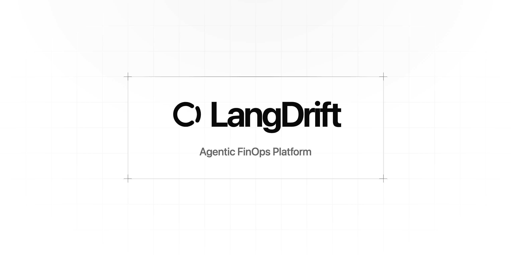

<p align="center">
  <picture>
    <source media="(prefers-color-scheme: dark)" srcset="https://raw.githubusercontent.com/jonatassales/lang-drift/main/packages/docs/assets/images/langdrift-banner-dark.png">
    
  </picture>
</p>

<p align="center">
  <strong>Agent-assisted delivery, accountable to your team's budget.</strong><br>
  Pre-execution cost governance and bounded runtimes for AI coding agents. Built for humans and agents.
</p>

<p align="center">
  <strong>English</strong> ·
  <a href="/packages/docs/README.pt-br.md">Português (Brasil)</a> ·
  <a href="/packages/docs/README.zh-hant.md">繁體中文</a> ·
  <a href="/packages/docs/README.ja.md">日本語</a> ·
  <a href="/packages/docs/README.vi.md">Tiếng Việt</a>
</p>

<p align="center">
  <a href="https://www.npmjs.com/package/@langdrift/cli"></a>
</p>

<p align="center">
  <a href="https://langdrift.md">Website</a> ·
  <a href="#features">Features</a> ·
  <a href="#how-to-use-it">How to use it</a> ·
  <a href="#configuration">Configuration</a> ·
  <a href="#references">References</a> ·
  <a href="#acknowledgements">Acknowledgements</a> ·
  <a href="#license">License</a>
</p>

## Features

- **Pre-execution budget reservations:** Every model call and cloud resource is estimated at dated list prices and reserved against your team's budget envelope before execution starts. If an estimate exceeds the cap, execution pauses before spend occurs.
- **Bounded microruntimes:** Plan and run isolated local environments (Docker, kind, Terraform, Kubernetes) tailored to your existing software, without embedding proprietary vendor SDKs into your application code.
- **Bring your own coding agent:** Drive delivery through your preferred agent driver (such as Claude Code) across structured workflow stages (planning, implementation, review), with deterministic human-in-the-loop checkpoints.
- **Deterministic audit trails:** Leave token-free evidence trails, verifiable run ledgers, and episodic memories that inform subsequent plans.

## How to use it

### Prerequisites

- **macOS** or **Linux**
- **Node.js 24+** (to run `@langdrift/cli` via `npx`)
- **Docker**, **kind**, **kubectl**, and **Terraform** (to run bounded local microruntimes; check your setup anytime with `npx @langdrift/cli doctor`)
- `ANTHROPIC_API_KEY` set in your environment (for the model planner and judge)

### 1. Initialize your project

Run the initializer from the root of your repository:

```sh
npx @langdrift/cli init
```

This creates project identity configuration in `.langdrift/config.json` and local execution rules in `.langdrift/microruntimes/AGENTS.md`. Existing files remain untouched. Add `/.langdrift/` to your `.gitignore`: it contains local runtime state generated by `ex`.

### 2. Plan from a ticket

Point `ex` to a ticket or specification. It reads linked documents, sizes CPU and memory bounds within your envelope, suggests the optimal model and effort, and writes a bounded execution plan:

```sh
npx @langdrift/cli agent plan <path-to-ticket.md> --component name=console,path=apps/console
```

> **Tip:** Use `--no-judge` to produce a plan purely from heuristics without making an LLM call, ensuring zero spend.

<p align="center">
  
</p>

The plan is written to `.langdrift/microruntimes/runtimes/<runtime-id>/runtime.md`. The `langdrift` fence contains the executable configuration:

```json
{
  "llmBudgetUsd": 25,
  "version": 2,
  "runtimeId": "console-microruntime",
  "revision": 1,
  "cpuMillis": 2000,
  "memoryMiB": 3072,
  "model": "claude-sonnet-5-5",
  "effort": "medium",
  "components": [
    {
      "name": "console",
      "path": "apps/console",
      "dockerfile": "Dockerfile",
      "port": 3001
    }
  ]
}
```

A component points at files: its name and its folder, which holds a Dockerfile. `ex` builds it with `docker build` against that Dockerfile from the project root, tags the image `langdrift-<runtime-id>-<name>:r<revision>`, and takes the port from its first `EXPOSE` and readiness from its own `HEALTHCHECK`. A `--component` may add `dockerfile=`, `port=`, `readiness=tcp` or `readiness=http:/path`, a committed `env-file=` without secrets, and `pass-env=A;B` for variables `ex` reads from its own environment at start; it writes both into one Kubernetes Secret per component.

### 3. Run the plan

Executing the runtime authorizes the plan and launches the delivery cycle:

```sh
npx @langdrift/cli agent run <runtime-id>
```

During execution, `ex` coordinates the entire delivery lifecycle:

1. **Gate check:** Verifies that list prices cover the run and reserves the estimated cost against the ticket allocation and period envelope.
2. **Local runtime:** Before any stage, builds each component from its Dockerfile and starts the components in a local kind cluster, each named after its component, waiting on their readiness probes until healthy. The bring-up has its own 20-minute timeout, enough for four image builds; a bring-up that fails or times out ends the lap as failed, takes down what started, releases the reservation and keeps the evidence, and no stage is played.
3. **Workflow stages:** Drives the coding agent through the stages defined in your workflow, with the runtime up. When human approval is required, execution pauses with the runtime running until confirmed via terminal prompt or `npx @langdrift/cli agent confirm <runtime-id> <stage>`. A stage that fails ends the lap as failed the same way; the next run opens a new lap and plays the stage again.
4. **Delivery observation:** Observes Git commits, branches, and PR checks read-only.
5. **Settlement:** Tears down local runtime resources, returns unspent budget reservations, and records the run in the audit ledger. A lap whose spend is unknown, because a call was cut off, holds its reservation instead.

### 4. Inspect status and diagnostics

Monitor active runs, inspect session events, and verify local tooling:

```sh
# Show current run status and lap state
npx @langdrift/cli agent status <runtime-id>

# Rebuild the episodic memory index from past runs
npx @langdrift/cli agent reindex

# Check native prerequisites and toolchain health
npx @langdrift/cli doctor
```

Append `--json` to `status` to stream NDJSON events formatted for console and dashboard integration.

## Configuration

You can customize workflow stages, coding agent drivers, and cost parameters using JSON configuration files in your repository:

<details>
<summary><code>workflow.json</code>: delivery stages and human checkpoints</summary>

```json
{
  "version": 1,
  "stages": [
    { "id": "planning", "label": "Planning", "skills": ["grilling"], "human": "required" },
    { "id": "spec", "label": "Spec", "skills": ["to-spec"], "human": "optional" },
    { "id": "implement", "label": "Implement", "skills": ["implement", "tdd", "code-review"], "human": "optional" },
    { "id": "review", "label": "Review", "skills": [], "human": "optional" },
    { "id": "merge", "label": "Merge", "skills": [], "human": "owner-only" }
  ],
  "defaults": { "humanAt": ["planning", "review", "merge"] },
  "efforts": ["low", "medium", "high"]
}
```

</details>

<details>
<summary><code>driver.json</code>: agent driver definition</summary>

```json
{
  "executable": "claude",
  "args": ["-p", "{{prompt}}", "--output-format", "json"],
  "passEnv": ["ANTHROPIC_API_KEY"],
  "timeoutSeconds": 1800,
  "usage": { "inputTokens": "usage.input_tokens", "outputTokens": "usage.output_tokens" },
  "summary": "result",
  "unmeasured": "pause"
}
```

</details>

<details>
<summary><code>prices.json</code>: token pricing list</summary>

```json
{
  "version": 1,
  "illustrative": true,
  "note": "Replace with your provider's current list prices.",
  "readOn": "2026-10-06",
  "currency": "USD",
  "unit": "cents-per-million-tokens",
  "cache": "uncached",
  "models": [
    { "id": "claude-sonnet-5-5", "name": "Claude Sonnet 5.5", "inputCents": 200, "outputCents": 1000 }
  ]
}
```

</details>

<details>
<summary><code>forecasts.json</code>: token forecasts by effort level</summary>

```json
{
  "version": 1,
  "illustrative": true,
  "unit": "thousands-of-tokens",
  "byEffort": {
    "low": { "input": 2000, "output": 120 },
    "medium": { "input": 3500, "output": 250 },
    "high": { "input": 6000, "output": 500 }
  },
  "planning": { "input": 35, "output": 5 }
}
```

</details>

## References

- [AI for FinOps: Agentic Use Cases in FinOps](https://www.finops.org/insights/ai-for-finops-agentic-use-cases/), Jonathan Morley, FinOps Foundation, March 27, 2026. Practitioners describe agents that reconcile spend against budgets, find waste and enforce cost policy earlier in the development lifecycle; that last theme, shifting FinOps left into delivery, is where LangDrift works.
- [Harness engineering for coding agent users](https://martinfowler.com/articles/harness-engineering.html), Birgitta Böckeler, martinfowler.com, April 2, 2026. It describes the outer harness a team builds around a coding agent: guides that steer the agent before it acts and sensors that let it correct itself. `ex harness` records that harness for a project, and the FinOps gates bound what it may spend.

## Acknowledgements

Thanks to [Matt Pocock](https://x.com/mattpocockuk). The agent skills this repository works with, from grilling to to-spec, to-tickets, implement, tdd and code-review, are adapted from [mattpocock/skills](https://github.com/mattpocock/skills) under the MIT License, and the example workflow above runs several of them.

## License

LangDrift is open-source software licensed under the [Apache License, Version 2.0](/LICENSE).
