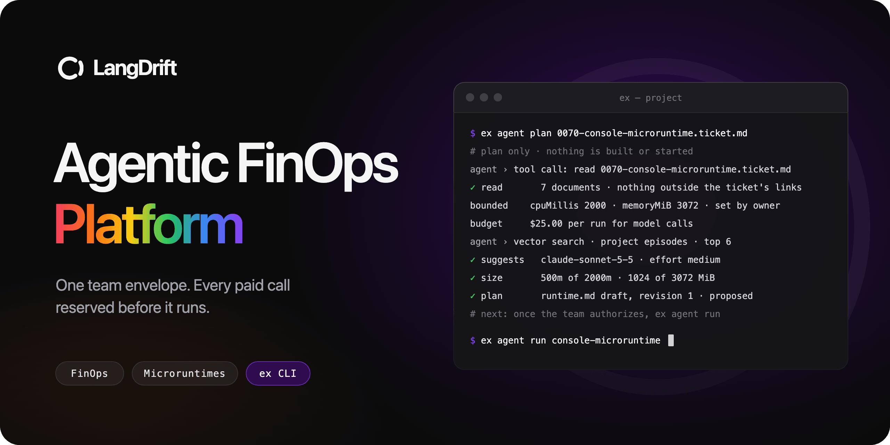

<p align="center">
  
</p>

<p align="center">
  <strong>エージェントによるデリバリーを、チームの予算に対して説明できるものに。</strong>
</p>

<p align="center">
  <a href="/README.md">English</a> ·
  <a href="/platform/docs/README.pt-br.md">Português (Brasil)</a> ·
  <a href="/platform/docs/README.zh-hant.md">繁體中文</a> ·
  <strong>日本語</strong> ·
  <a href="/platform/docs/README.vi.md">Tiếng Việt</a>
</p>

<p align="center">
  <a href="#プロジェクトの状況"></a>
  <a href="https://github.com/jonatassales/lang-drift/actions/workflows/pull-request.yml"></a>
  <a href="/packages/ex/README.md"></a>
  <a href="/package.json"></a>
  <a href="/apps/website/README.md"></a>
  <a href="/.agents/context.md"></a>
  <a href="https://langdrift.md/ja/"></a>
</p>

<p align="center">
  <a href="https://langdrift.md/ja/">ウェブサイト</a> ·
  <a href="#プロダクト">プロダクト</a> ·
  <a href="#予算枠">予算枠</a> ·
  <a href="#ex-をはじめる"><code>ex</code> をはじめる</a> ·
  <a href="#プロジェクトの状況">プロジェクトの状況</a>
</p>

## プロダクト

**LangDrift FinOps** は、エージェントによるデリバリーをチームの予算に対して説明できるものにします。チケットが求めること、エージェントが行う作業、その作業が残す証拠、そしてそれにかかった費用を、チームが確認できるひとつのつながりとして結びます。

**Microruntimes** はそのエンジンです。CLI の `ex` は、チケットとそこからリンクされたドキュメントを読み、既存のソフトウェアの周りに範囲の限られたローカル runtime を計画し、あなた自身のコーディングエージェントを通してデリバリーを進めます。有料呼び出しはすべて、実行前にチームの予算枠に対して予約されます。

タイムアウトしたモデル呼び出し、計画より高くついた再試行、チェック結果が返ってこないプルリクエスト。デリバリーはごく普通のことで計画から外れます。LangDrift が目指すのは、そのどれもが誰も承認していない支出や、誰も説明できない数字にならないことです。

### チームが得るもの

| 機能 | チームにとっての価値 |
| --- | --- |
| **チケットから計画** | `ex agent plan` はチケットとそこからリンクされたドキュメントだけを読み、比較可能な過去の実行を取り出し、チームの予算枠に収まるよう見積もった runtime の計画を書き出します。 |
| **支出の前に予約** | プランナーのものもコーディングエージェントのものも、有料呼び出しはすべて日付付きの定価で見積もられ、実行ごとの上限、チケットへの配分、期間の残額に対して予約されます。 |
| **あなたのハーネスでデリバリー** | ワークフローのステージとスキルは、あなたが設定したコーディングエージェントで実行されます。チームが決めた場面では人が確認し、マージは常にオーナーのものです。 |
| **既存ソフトウェアの周りに runtime** | コンポーネントは kind、Terraform、Kubernetes による範囲の限られたローカルのライフサイクルで起動し、あなたのコードに LangDrift への依存は入りません。 |
| **証拠のある記憶** | 実行のたびに、トークンを含まない証拠、台帳、そして次の計画が取り出す記憶が残ります。 |

LangDrift は実行の一周ごとに独自の言葉を使います。microruntime が車、ラン（run）がレース、そして**ラップ**（lap）がその一周です。ゲートで一時停止した試行の場合も、完走した実行の場合もあります。

## 予算枠

承認された予算は、開発者やチケットではなくチームのものです。チケットはその中で配分を受け、実行にはそれぞれ上限があります。

ラップを始める前に、`ex` は実行を定価で見積もり、チームの予約マージンを上乗せします。実行ごとの上限、チケットへの配分、期間の残額に収まる予約ならラップが始まり、収まらなければ何も支払わずに一時停止します。ラップの進行中は、有料呼び出しのたびにその前でゲートが確認します。終了すると、使われなかった予約は予算に戻ります。

| ゲート | 確認すること | 通らなかったとき |
| --- | --- | --- |
| **FG-01** | 日付付きの価格情報が有料の作業をカバーしている。 | ラップをブロックします。 |
| **FG-02** | チケットに配分がある。 | ラップをブロックします。 |
| **FG-03** | 見積もりにマージンを加えた額が、実行ごとの上限、配分、期間の残額に収まる。 | 何も支払う前に一時停止します。 |
| **FG-04** | ラップで観測された支出が予約額に達していない。 | 有料呼び出しを一時停止します。 |
| **FG-05** | 以前のラップの超過支出をオーナーが確認済みである。 | `--acknowledge-overspend` によるオーナーの確認が必要です。 |
| **FG-06** | プロバイダーが実行分を請求済みである。 | 数字を暫定のままにします。 |

**不明はゼロではありません。** 使用量を報告しない呼び出し、誰も確認できなかったクリーンアップ、まだ届いていない請求は、理由とともに不明のまま残り、照合されるまで予約も保持されます。

## あなたのスタック、あなたの判断

LangDrift が持つのは境界と仕組みです。アプリケーションとそのドメインの選択はあなたのチームのものです。

- **小さな足跡。** プロジェクトの中で `ex` が書き込むのは `.langdrift/` だけです。チケットがリンクする成果物を読み、プロジェクトの外は決して読まず、シークレットとシンボリックリンクは拒否します。
- **デリバリーは観測するだけ。** `ex` は push も、プルリクエストの作成も、マージもしません。デリバリーはあなたのハーネスのものであり、`ex` は `git` と `gh` を通してブランチ、プルリクエスト、そのチェックを観測します。
- **提案は承認ではありません。** プランナーはモデルと推論強度を提案しますが、計画を承認するのは runtime を実行することです。モデルの提案がスコープ、資金、アクセスを広げることはありません。
- **認証情報は環境の中に。** プランナーは呼び出しの時点で `ANTHROPIC_API_KEY` を読み、コーディングエージェントには最小限の環境と、あなたが指定した変数だけが渡されます。`ex` が認証情報をコマンド引数で受け取ることはありません。

実行をブロックまたは許可しうる入力はすべて、誰が、いつ、何を通して設定したかとともに記録されます。`.langdrift/` の JSON ファイルはその記録を読むためのミラーであり、ミラーを編集してもゲートが読む内容は何も変わりません。

## プロジェクトの状況

**LangDrift は開発中です。** ウェブサイトは [langdrift.md](https://langdrift.md/ja/) で五つの言語で公開されています。コンソールは `extub` を読み込みます。これは LangDrift Studio というひとつのプロジェクトを用意するスタブ API で、その FinOps の数値はイメージであると明示されています。`ex` はソースからビルドするローカル開発用の候補版で、バイナリは公開されていません。

`ex agent plan` と `ex agent run` はプロジェクト内でローカルに動作し、お金のゲートは `ex` の中でプロジェクト自身の台帳に対して実行されます。サーバーで共有するチームの台帳はまだ作られていません。接続エージェント（`ex agent connect`、`project`、`supervise`、`migrate`）には、このリポジトリにまだないサーバーが必要です。テストスイートは、スクリプト化したモデル、コーディングエージェント、ライフサイクルで CLI を動かすもので、実際のクラスターの起動、実際の支出、本番環境での準備が整っていることを示すものではありません。ウェブサイトでの登録は一時停止中です。

| パス | 内容 |
| --- | --- |
| [`apps/website`](/apps/website/README.md) | langdrift.md のプラットフォームサイト：ホーム、FinOps、Microruntimes、料金、早期アクセス。 |
| [`apps/console`](/apps/console/README.md) | チームが FinOps と microruntimes を管理するコンソール。 |
| [`apps/extub`](/apps/extub/README.md) | コンソールが読み込むローカルの Go スタブ API。 |
| [`packages/ex`](/packages/ex/README.md) | Go で書かれた `ex` CLI。 |
| [`packages/contracts`](/packages/contracts/README.md) | Microruntimes の契約：`runtime.md` のブロックとエージェントのプロトコル。 |
| [`packages/tokens`](/packages/tokens) · [`packages/web`](/packages/web) | デザイントークンと共有 UI。 |

## `ex` をはじめる

macOS または Linux と、Go 1.26 以降が必要です。計画するだけならこれで十分です。プランナーのモデルによる判定は `ANTHROPIC_API_KEY` を読みます。ラップを実行するには、さらに Docker、kind、kubectl、Terraform（`ex doctor` が確認し、何もインストールしません）、Claude Code などあなたが設定するコーディングエージェント、そしてプルリクエストを観測するための `gh` が必要です。

### 1. CLI をビルドする

```sh
git clone https://github.com/jonatassales/lang-drift.git
cd lang-drift/packages/ex
GOTOOLCHAIN=local go build -o dist/ex ./src
./dist/ex version
```

`version` は `ex 0.0.0-dev` を表示します。システムにはすでに Vi の行エディターである `ex` があるかもしれないので、こちらはパスで呼び出してください。以下の手順では `packages/ex/dist/ex` を `ex` と書きます。このシェルの中だけなら、`alias ex="$PWD/dist/ex"` でそうできます。

### 2. プロジェクトを初期化する

すぐに試せるプロジェクトとして、テストスイートが計画するプロジェクトをコピーします。チケットが一つ、そこからリンクされたスペック、リサーチ、ADR、ガードレール、そして二つのアプリのマニフェストが入っています。

```sh
cp -R src/testdata/langdrift/project /tmp/ex-demo
cd /tmp/ex-demo
ex init
```

`ex init` は `.langdrift/config.json` にプロジェクトの識別情報を、`.langdrift/microruntimes/AGENTS.md` に実行ルールを作成し、既存のファイルには手を加えません。自分のリポジトリでは `/.langdrift/` を `.gitignore` に追加してください。そこは `ex` が書き込むマシンローカルの状態であり、チームが書くものは何も置かれません。

### 3. ハーネスを記録する

[入力ファイルの例](#入力ファイルの例)をプロジェクトに保存し、デリバリーのハーネスを記録します。ハードウェアの予算枠、ワークフローのステージ、既定のモデルと推論強度、そしてステージを実行するコーディングエージェントです。

```sh
ex harness envelope set --per-execution-cpu-millis 4000 --per-execution-memory-mib 6144 \
  --default-cpu-millis 2000 --default-memory-mib 3072 --not-runtime-field gpu
ex harness workflow set --file workflow.json
ex harness model set claude-sonnet-5-5 --effort medium
ex harness driver set --file driver.json
```

### 4. お金のルールを記録する

この予算は、2026 年 10 月分としてチームに 500.00 ドルを与え、実行ごとの上限を 25.00 ドルとし、すべての見積もりに 20% のマージンを予約し、チケット 0070 に 25.00 ドルを配分します。金額の単位はセントです。

```sh
ex finops budget set --period 2026-10 --period-cents 50000 --per-run-cents 2500 \
  --reserve-margin-percent 20 --allocate 0070-console-microruntime=2500
ex finops gates set --default
ex finops prices set --file prices.json --slug list
ex finops forecasts set --file forecasts.json
```

各コマンドは書き込んだ記録を表示し、入力系のコマンドはすべて、設定した人を記録する `--by` を受け付けます。

### 5. チケットから計画する

runtime がビルドして実行するコンポーネントを指定し、`ex` にチケットを読ませます。`--no-judge` はモデルを呼び出さずに計画するので、何も支払いは発生しません。これを付けずに `ANTHROPIC_API_KEY` を設定すると、プランナーはラップと同じゲートのもとでモデルを通して情報源を判定し、その費用は台帳の計画の行に記録されます。

```sh
ex agent plan .agents/workflow/tickets/0070-console-microruntime.ticket.md --no-judge \
  --component "path=apps/console,image=langdrift-console:local,port=3001,readiness=/icon.svg,build=docker,args=build -t langdrift-console:local ."
```

CLI の出力は英語です。

```text
ex agent plan 0070-console-microruntime.ticket.md
# plan only · nothing is built or started · the planner's calls are paid and gated
agent › tool call: read 0070-console-microruntime.ticket.md
agent › needs-triage · links 0010-exphere-and-the-langdrift-folder.spec.md · ex-microruntimes-capability.research.md · 0002-console-input-is-untrusted.adr.md · 0001-finops.gr.md · package.json · go.mod
judge      unavailable · --no-judge; verdicts, facts and the suggestion are the inputs' own
# analysis · reading the linked documents, then the project's episodes
agent › tool call: read 0010-exphere-and-the-langdrift-folder.spec.md · read
agent › tool call: read ex-microruntimes-capability.research.md · read
agent › tool call: read 0002-console-input-is-untrusted.adr.md · read
agent › tool call: read 0001-finops.gr.md · read
agent › tool call: read package.json · read
agent › tool call: read go.mod · read
✓ read       7 documents · nothing outside the ticket's links
reads      .langdrift/harness/guardrails/0001-finops.gr.md · FIN-01 · FIN-02 · FIN-03 · FIN-04 · FIN-05 · FIN-06 · FIN-07 · FIN-08
bounded    cpuMillis 2000 · memoryMiB 3072 · set by owner in the CLI · record envelope-b228
budget     $25.00 per run for model calls · set by owner in the CLI
agent › RAG over project episodes · a model and effort for this ticket
agent › embedding the ticket intent · 1 query vector
agent › vector search · project episodes · top 6 by cosine similarity
agent › 0 candidates · no episode indexed yet
agent › dropped 0 below 0.55 · kept 0
agent › 0 episodes cited · none with measured resources
agent › reasoning · no cited episode measured cpu or memory · sizing follows the inputs, not history
✓ suggests   claude-sonnet-5-5 · effort medium
# plan · resolving the components, then sizing them inside the envelope
agent › resolving 1 components named in the CLI · paths, images, ports
agent › tool call: inspect apps/console · package.json · :3001
✓ apps/console          Node.js+Next.js · web 500m · 1024 MiB
agent › cross-checking · 1 ports distinct · 1 images resolved · no collisions
✓ size       500m of 2000m · 1024 of 3072 MiB · 1 one-replica Deployments · proposed shares
limits     gpu and disk are not runtime.md fields · none requested
estimate   runtime has no price source · cpu and memory stay in millicores and MiB
agent › tool call: validate runtime.md draft against the schema · 0 errors
✓ plan       runtime.md draft, revision 1 · proposed · authorize with ex agent run
# next: once the team authorizes, ex agent run applies the recorded intent
```

計画は `.langdrift/microruntimes/runtimes/console-microruntime/runtime.md` に書き出されます。`langdrift` ブロックが runtime の実行する内容で、二つ目の `langdrift-plan` ブロックに分析が入ります。ファイル内の文章は文脈として残るだけで、実行されることはありません。

```json
{
  "llmBudgetUsd": 25,
  "runtimeId": "console-microruntime",
  "revision": 1,
  "cpuMillis": 2000,
  "memoryMiB": 3072,
  "model": "claude-sonnet-5-5",
  "effort": "medium",
  "components": [
    {
      "path": "apps/console",
      "image": "langdrift-console:local",
      "port": 3001,
      "readinessPath": "/icon.svg",
      "build": { "executable": "docker", "args": ["build", "-t", "langdrift-console:local", "."] }
    }
  ]
}
```

この抜粋では、ブロックのバージョン、名前、そして `ex` が管理する runtime とプロジェクトの識別情報を省いています。runtime が停止している間に同じチケットを再び計画すると、リビジョンが上がります。

### 6. 計画を実行する

runtime を実行することが、その計画の承認になります。ラップはイメージをビルドし、プロジェクトのローカルクラスターを起動し、コーディングエージェントを通して有料呼び出しを行うので、先に `ex doctor` を実行してください。

```sh
ex agent run console-microruntime
```

1. **ゲート。** 実行は意図、定価での見積もり、実行ごとの予算を表示してから予約します。すべての上限に収まる予約ならラップが始まり、超えていれば何も支払わずに一時停止します。
2. **ステージ。** 各ステージはコーディングエージェントを通して順に実行され、一行の要約を表示します。人が関わるステージはオーナーを待ちます。ターミナルで答えるか、`--confirm` を使うか、あとで `ex agent confirm console-microruntime planning` を実行します。`owner-only` のステージは決して実行されません。
3. **runtime。** コンポーネントはブロックに従ってプロジェクトの kind クラスター上で起動し、準備が整うと実行がそれを知らせます。
4. **デリバリー。** 実行はブランチ、プルリクエスト、そのチェックを観測します。`--checks-wait` で追いかける時間を制限できます。
5. **精算。** runtime が停止し、使われなかった予約が予算に戻り、記憶 `run.md` が書き込まれ、エピソードのインデックスが再構築されます。実行は、レビューやマージの準備ができているかどうかと、次に何をすべきかを伝えます。

すべての変更は、ラップのファイル、`run.json`、台帳に記録されます。

### 7. 実行を追う

```sh
ex agent status console-microruntime
ex agent reindex
ex doctor
```

`status` は実行の記録と進行中のラップを、`reindex` はすべての runtime の記憶からエピソードのインデックスを再構築し、`doctor` はネイティブツールを確認します。`--json` を付けると、セッションの各行が NDJSON のイベント `{at, session, kind, id, text, card, field, data}` になるので、コンソールやターミナル UI で同じセッションを表示できます。

| 終了コード | 意味 |
| --- | --- |
| `0` | 成功、または人を待っている実行。 |
| `1` | 操作が失敗した：スキル、フック、ビルド、起動のいずれか。 |
| `2` | 使い方が正しくない。 |
| `3` | お金のゲートなど、ガードやポリシーによって拒否された。 |
| `4` | 前提条件が足りない：ツール、入力、クラスター、runtime の記録のいずれか。 |
| `130` | 中断された。 |

コマンドの完全なリファレンス、`.langdrift/` の構成、復旧のルールは、英語の [`ex` README](/packages/ex/README.md) にあります。

### 入力ファイルの例

<details>
<summary><code>workflow.json</code>：ステージ、そのスキル、人が関わる場面</summary>

```json
{
  "version": 1,
  "stages": [
    { "id": "planning", "label": "Planning", "skills": ["grilling"], "human": "required" },
    { "id": "spec", "label": "Spec", "skills": ["to-spec"], "human": "optional" },
    { "id": "implement", "label": "Implement", "skills": ["implement", "tdd", "code-review"], "human": "optional" },
    { "id": "review", "label": "Review", "skills": [], "human": "optional" },
    { "id": "merge", "label": "Merge", "skills": [], "human": "owner-only" }
  ],
  "defaults": { "humanAt": ["planning", "review", "merge"] },
  "efforts": ["low", "medium", "high"]
}
```

ステージには `hooks` も指定できます。プロジェクトの中で、`sh` を通して最初に実行される、コミット済みのスクリプトです。

</details>

<details>
<summary><code>driver.json</code>：ステージを実行するコーディングエージェント</summary>

```json
{
  "executable": "claude",
  "args": ["-p", "{{prompt}}", "--output-format", "json"],
  "passEnv": ["ANTHROPIC_API_KEY"],
  "timeoutSeconds": 1800,
  "usage": { "inputTokens": "usage.input_tokens", "outputTokens": "usage.output_tokens" },
  "summary": "result",
  "unmeasured": "pause"
}
```

実行ファイルはプロジェクトのルートから、シェルを介さずに実行されます。`usage` は出力のどこにトークン数があるかを示します。報告のない呼び出しは支出が不明のままになり、`"unmeasured": "pause"` によって FG-04 が次の有料呼び出しを一時停止します。

</details>

<details>
<summary><code>prices.json</code>：すべての見積もりの根拠となる日付付きの定価</summary>

```json
{
  "version": 1,
  "illustrative": true,
  "note": "Replace with your provider's current list prices.",
  "readOn": "2026-10-06",
  "currency": "USD",
  "unit": "cents-per-million-tokens",
  "cache": "uncached",
  "models": [
    { "id": "claude-sonnet-5-5", "name": "Claude Sonnet 5.5", "inputCents": 200, "outputCents": 1000 }
  ]
}
```

これらの数字は形式を示すためのイメージであり、検証済みの価格表ではありません。

</details>

<details>
<summary><code>forecasts.json</code>：推論強度ごとに見込まれるトークン</summary>

```json
{
  "version": 1,
  "illustrative": true,
  "unit": "thousands-of-tokens",
  "byEffort": {
    "low": { "input": 2000, "output": 120 },
    "medium": { "input": 3500, "output": 250 },
    "high": { "input": 6000, "output": 500 }
  },
  "planning": { "input": 35, "output": 5 }
}
```

`planning` はプランナー自身の呼び出しを対象とします。チケットの過去の実行でトークンが計測されていないときに、この予測が使われます。

</details>

### ウェブサイトとコンソールを試す

Node.js 24 と pnpm 12 を使い、リポジトリのルートで次を実行します。

```sh
pnpm install
pnpm website
```

サイトは `http://localhost:3000` で動きます。`pnpm console` は `http://127.0.0.1:3001` でコンソールを、その隣の `127.0.0.1:3401` で `extub` を起動します。`extub` には Go が必要です。コンソールに表示される数字はすべてスタブから来ています。

## LangDrift を支える仕事

LangDrift は [Jonatas Sales](https://github.com/jonatassales) が手がけ、FinOps の実践、エージェントによるデリバリー、プラットフォームエンジニアリングを組み合わせています。Exphere プロジェクトから生まれ、pnpm と Turborepo のモノレポとして作られています。ウェブサイトとコンソールは TypeScript と Next.js、React、Tailwind CSS で、`ex` と Microruntimes の契約は Go で書かれ、プランナーには公式の Anthropic Go SDK を使っています。

このリポジトリはスペックを起点に作られています。すべての変更は [`.agents/workflow/`](/.agents/workflow) にあるスペックとそのチケットから始まり、それは `ex` が計画するのと同じ種類のチケットです。フィードバックは [GitHub の issue](https://github.com/jonatassales/lang-drift/issues) からお寄せください。

## 参考文献

- [AI for FinOps: Agentic Use Cases in FinOps](https://www.finops.org/insights/ai-for-finops-agentic-use-cases/)、Jonathan Morley、FinOps Foundation、2026 年 3 月 27 日。実務者たちが、支出を予算と照合し、無駄を見つけ、開発ライフサイクルのより早い段階でコストポリシーを適用するエージェントについて語っています。最後のテーマ、つまり FinOps をデリバリーの中へ持ち込むことこそ、LangDrift が取り組む領域です。
- [Harness engineering for coding agent users](https://martinfowler.com/articles/harness-engineering.html)、Birgitta Böckeler、martinfowler.com、2026 年 4 月 2 日。チームがコーディングエージェントの周りに築く外側のハーネス、つまりエージェントが動く前に方向づけるガイドと、自己修正を可能にするセンサーについて述べています。`ex harness` はそのハーネスをプロジェクトごとに記録し、FinOps のゲートはそれが使える金額を制限します。

## 謝辞

[Matt Pocock](https://x.com/mattpocockuk) に感謝します。このリポジトリで使っているエージェントのスキル、grilling から to-spec、to-tickets、implement、tdd、code-review までは、MIT ライセンスで公開されている [mattpocock/skills](https://github.com/mattpocock/skills) を改変したもので、上のワークフロー例でもそのいくつかを使っています。
