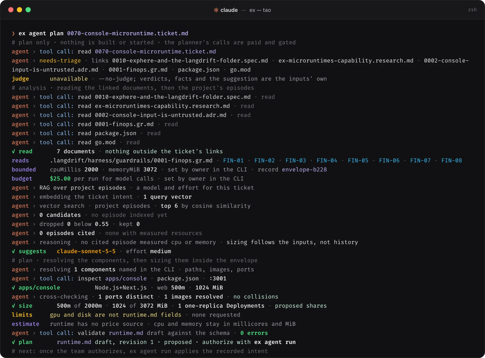

<p align="center">
  <picture>
    <source media="(prefers-color-scheme: dark)" srcset="/platform/docs/assets/images/langdrift-banner-dark.png">
    
  </picture>
</p>

<p align="center">
  <strong>Bàn giao với sự hỗ trợ của tác tử, chịu trách nhiệm trước ngân sách của nhóm bạn.</strong><br>
  Quản trị chi phí trước khi thực thi và microruntime có giới hạn cho các tác tử AI. Xây dựng cho con người và tác tử.
</p>

<p align="center">
  <a href="/README.md">English</a> ·
  <a href="/platform/docs/README.pt-br.md">Português (Brasil)</a> ·
  <a href="/platform/docs/README.zh-hant.md">繁體中文</a> ·
  <a href="/platform/docs/README.ja.md">日本語</a> ·
  <strong>Tiếng Việt</strong>
</p>

<p align="center">
  <a href="https://www.npmjs.com/package/@langdrift/ex"></a>
</p>

<p align="center">
  <a href="https://langdrift.md/vi/">Trang web</a> ·
  <a href="#tính-năng">Tính năng</a> ·
  <a href="#cách-sử-dụng">Cách sử dụng</a> ·
  <a href="#cấu-hình">Cấu hình</a> ·
  <a href="#tài-liệu-tham-khảo">Tài liệu tham khảo</a> ·
  <a href="#lời-cảm-ơn">Lời cảm ơn</a> ·
  <a href="#giấy-phép">Giấy phép</a>
</p>

## Tính năng

- **Bảo lưu ngân sách trước khi thực thi:** Mỗi lượt gọi mô hình và tài nguyên đám mây đều được ước tính theo bảng giá niêm yết có ghi ngày và bảo lưu trong hạn mức ngân sách của nhóm trước khi bắt đầu thực thi. Nếu ước tính vượt quá trần, quá trình thực thi sẽ tạm dừng trước khi phát sinh chi phí.
- **Microruntime có giới hạn:** Lập kế hoạch và chạy các môi trường cục bộ độc lập (Docker, kind, Terraform, Kubernetes) phù hợp với phần mềm sẵn có của bạn mà không cần cài đặt các SDK độc quyền của bên thứ ba vào mã nguồn ứng dụng.
- **Sử dụng tác tử viết mã tùy chọn:** Thực hiện quy trình bàn giao thông qua trình điều khiển tác tử ưa thích (chẳng hạn như Claude Code) qua các giai đoạn quy trình có cấu trúc (lập kế hoạch, triển khai, đánh giá), với các điểm kiểm tra rõ ràng có sự xác nhận của con người.
- **Nhật ký kiểm toán có tính xác định:** Để lại bằng chứng không tiêu tốn token, sổ cái thực thi có thể kiểm chứng và ký ức theo giai đoạn để cung cấp thông tin cho các kế hoạch tiếp theo.

## Cách sử dụng

### Điều kiện tiên quyết

- **macOS** hoặc **Linux**
- **Node.js 24+** (để chạy `@langdrift/ex` qua `npx`)
- **Docker**, **kind**, **kubectl** và **Terraform** (để chạy microruntime cục bộ có giới hạn; kiểm tra môi trường bất kỳ lúc nào với `npx @langdrift/ex doctor`)
- `ANTHROPIC_API_KEY` đã được thiết lập trong môi trường (cho bộ lập kế hoạch và thẩm định mô hình)

### 1. Khởi tạo dự án của bạn

Chạy lệnh khởi tạo từ thư mục gốc của kho lưu trữ:

```sh
npx @langdrift/ex init
```

Lệnh này tạo cấu hình định danh dự án trong `.langdrift/config.json` và các quy tắc thực thi cục bộ trong `.langdrift/microruntimes/AGENTS.md`. Các tệp hiện có không bị thay đổi. Hãy thêm `/.langdrift/` vào `.gitignore` của bạn: thư mục này chứa trạng thái cục bộ do `ex` tạo ra.

### 2. Lập kế hoạch từ một ticket

Trỏ `ex` tới một ticket hoặc bản đặc tả. Công cụ sẽ đọc các tài liệu liên kết, xác định giới hạn CPU và bộ nhớ trong hạn mức của bạn, đề xuất mô hình và mức độ nỗ lực tối ưu, đồng thời ghi lại kế hoạch thực thi có giới hạn:

```sh
npx @langdrift/ex agent plan <đường-dẫn-đến-ticket.md>
```

> **Mẹo:** Sử dụng `--no-judge` để tạo kế hoạch thuần túy theo kinh nghiệm heuristics mà không cần gọi LLM, hoàn toàn không phát sinh chi phí.

<p align="center">
  
</p>

Kế hoạch được lưu trong `.langdrift/microruntimes/runtimes/<runtime-id>/runtime.md`. Khối `langdrift` chứa cấu hình có thể thực thi:

```json
{
  "llmBudgetUsd": 25,
  "runtimeId": "console-microruntime",
  "revision": 1,
  "cpuMillis": 2000,
  "memoryMiB": 3072,
  "model": "claude-sonnet-5-5",
  "effort": "medium",
  "components": [
    {
      "path": "apps/console",
      "image": "langdrift-console:local",
      "port": 3001,
      "readinessPath": "/icon.svg",
      "build": { "executable": "docker", "args": ["build", "-t", "langdrift-console:local", "."] }
    }
  ]
}
```

### 3. Chạy kế hoạch

Thực thi runtime đồng nghĩa với việc phê duyệt kế hoạch và khởi chạy chu trình bàn giao:

```sh
npx @langdrift/ex agent run <runtime-id>
```

Trong quá trình thực thi, `ex` điều phối toàn bộ vòng đời bàn giao:

1. **Kiểm tra cổng chi phí:** Xác minh giá niêm yết bao quát lượt chạy và bảo lưu chi phí ước tính theo phân bổ của ticket và hạn mức kỳ hạn.
2. **Các giai đoạn quy trình:** Điều khiển tác tử viết mã qua các giai đoạn được định nghĩa trong quy trình làm việc của bạn. Khi cần con người phê duyệt, quá trình thực thi sẽ tạm dừng cho đến khi được xác nhận qua terminal hoặc `npx @langdrift/ex agent confirm <runtime-id> <giai-đoạn>`.
3. **Runtime cục bộ:** Xây dựng image và khởi chạy các thành phần trong cụm kind cục bộ, thăm dò các điểm cuối sẵn sàng cho đến khi hệ thống ổn định.
4. **Quan sát bàn giao:** Giám sát các commit Git, nhánh và kiểm tra PR ở chế độ chỉ đọc.
5. **Quyết toán:** Giải phóng tài nguyên runtime cục bộ, hoàn trả các khoản bảo lưu ngân sách chưa sử dụng và ghi lại lượt chạy vào sổ cái kiểm toán.

### 4. Kiểm tra trạng thái và chẩn đoán

Theo dõi các lượt chạy đang hoạt động, kiểm tra sự kiện phiên và xác minh các công cụ cục bộ:

```sh
# Hiển thị trạng thái lượt chạy hiện tại và trạng thái vòng lặp
npx @langdrift/ex agent status <runtime-id>

# Tái tạo chỉ mục ký ức theo giai đoạn từ các lượt chạy trước
npx @langdrift/ex agent reindex

# Kiểm tra các điều kiện tiên quyết và tính toàn vẹn của chuỗi công cụ
npx @langdrift/ex doctor
```

Thêm `--json` vào lệnh `status` để truyền luồng sự kiện NDJSON định dạng cho việc tích hợp bảng điều khiển và bảng điều khiển.

## Cấu hình

Bạn có thể tùy chỉnh các giai đoạn quy trình làm việc, trình điều khiển tác tử và thông số chi phí bằng các tệp cấu hình JSON trong kho lưu trữ của mình:

<details>
<summary><code>workflow.json</code>: các giai đoạn bàn giao và điểm kiểm tra của con người</summary>

```json
{
  "version": 1,
  "stages": [
    { "id": "planning", "label": "Planning", "skills": ["grilling"], "human": "required" },
    { "id": "spec", "label": "Spec", "skills": ["to-spec"], "human": "optional" },
    { "id": "implement", "label": "Implement", "skills": ["implement", "tdd", "code-review"], "human": "optional" },
    { "id": "review", "label": "Review", "skills": [], "human": "optional" },
    { "id": "merge", "label": "Merge", "skills": [], "human": "owner-only" }
  ],
  "defaults": { "humanAt": ["planning", "review", "merge"] },
  "efforts": ["low", "medium", "high"]
}
```

</details>

<details>
<summary><code>driver.json</code>: định nghĩa trình điều khiển tác tử viết mã</summary>

```json
{
  "executable": "claude",
  "args": ["-p", "{{prompt}}", "--output-format", "json"],
  "passEnv": ["ANTHROPIC_API_KEY"],
  "timeoutSeconds": 1800,
  "usage": { "inputTokens": "usage.input_tokens", "outputTokens": "usage.output_tokens" },
  "summary": "result",
  "unmeasured": "pause"
}
```

</details>

<details>
<summary><code>prices.json</code>: bảng giá token</summary>

```json
{
  "version": 1,
  "illustrative": true,
  "note": "Replace with your provider's current list prices.",
  "readOn": "2026-10-06",
  "currency": "USD",
  "unit": "cents-per-million-tokens",
  "cache": "uncached",
  "models": [
    { "id": "claude-sonnet-5-5", "name": "Claude Sonnet 5.5", "inputCents": 200, "outputCents": 1000 }
  ]
}
```

</details>

<details>
<summary><code>forecasts.json</code>: dự báo token theo mức độ nỗ lực</summary>

```json
{
  "version": 1,
  "illustrative": true,
  "unit": "thousands-of-tokens",
  "byEffort": {
    "low": { "input": 2000, "output": 120 },
    "medium": { "input": 3500, "output": 250 },
    "high": { "input": 6000, "output": 500 }
  },
  "planning": { "input": 35, "output": 5 }
}
```

</details>

## Tài liệu tham khảo

- [AI for FinOps: Agentic Use Cases in FinOps](https://www.finops.org/insights/ai-for-finops-agentic-use-cases/), Jonathan Morley, FinOps Foundation, ngày 27 tháng 3 năm 2026. Những người thực hành mô tả các tác tử đối soát chi tiêu với ngân sách, tìm ra lãng phí và áp dụng chính sách chi phí sớm hơn trong vòng đời phát triển; chủ đề cuối cùng đó, đưa FinOps vào ngay trong quá trình bàn giao, chính là nơi LangDrift hoạt động.
- [Harness engineering for coding agent users](https://martinfowler.com/articles/harness-engineering.html), Birgitta Böckeler, martinfowler.com, ngày 2 tháng 4 năm 2026. Bài viết mô tả lớp harness bên ngoài mà một đội xây quanh tác tử lập trình: các chỉ dẫn định hướng tác tử trước khi nó hành động và các cảm biến giúp nó tự sửa lỗi. `ex harness` ghi lại harness đó cho từng dự án, còn các cổng kiểm soát FinOps giới hạn số tiền nó được chi.

## Lời cảm ơn

Xin cảm ơn [Matt Pocock](https://x.com/mattpocockuk). Các skill tác tử mà kho mã này sử dụng, từ grilling đến to-spec, to-tickets, implement, tdd và code-review, được chuyển thể từ [mattpocock/skills](https://github.com/mattpocock/skills) theo giấy phép MIT, và quy trình mẫu ở trên dùng một vài skill trong số đó.

## Giấy phép

LangDrift là phần mềm mã nguồn mở được phát hành theo [Giấy phép Apache 2.0](/LICENSE).
